# Workflows POC — Backend End-to-End Technical Documentation

> **Scope:** the backend in `server/` (NestJS 12 + DBOS 5 + Postgres + GTWY + viaSocket). It also covers the parts of `web/` that change how the backend is reached: the `/api` proxy, the client retry logic and the polling intervals. The standalone `mastra-spike/` scripts are summarised in §15.
> **Source baseline:** git `HEAD` = `245ec15` ("Merge pull request #9 … exact_gtwy_ai_cost"), plus the uncommitted working-tree state at the time of writing.
> **Method:** every statement comes from reading the source. Line ranges are given as `file:start-end`. Where behaviour depends on a third-party library (DBOS, NestJS, Node) rather than on this repo, it is marked **[library behaviour]**. Anything that could not be confirmed from code is marked **[unverified]**.

**Legend:** ✅ verified in code · ⚠️ risk or edge case supported by code · **[unverified]** not confirmable from this repo

---

## Table of contents

1. [System overview](#1-system-overview)
2. [Bootstrap, configuration and infrastructure](#2-bootstrap-configuration-and-infrastructure)
3. [Cross-cutting concerns (auth, validation, errors, logging)](#3-cross-cutting-concerns)
4. [Data model](#4-data-model)
5. [API reference (all 31 endpoints)](#5-api-reference)
   - 5.1 [Workflows](#51-workflows-module) · 5.2 [Actions](#52-actions-module) · 5.3 [Integrations](#53-integrations-module) · 5.4 [Playground](#54-playground-module) · 5.5 [Widget](#55-widget-module) · 5.6 [Runs and approvals](#56-runs-and-approvals-module)
6. [Core flow: customer message → routing → run](#6-core-flow-customer-message--routing--run)
7. [The durable runner (DBOS)](#7-the-durable-runner-dbos)
8. [Workflow definitions: tree, graph, validation, Flow](#8-workflow-definitions-tree-graph-validation-flow)
9. [Action execution and idempotency](#9-action-execution-and-idempotency)
10. [LLM layer (GTWY)](#10-llm-layer-gtwy)
11. [viaSocket integration](#11-viasocket-integration)
12. [Approvals lifecycle](#12-approvals-lifecycle)
13. [Attachments and file storage](#13-attachments-and-file-storage)
14. [Web-side backend touchpoints](#14-web-side-backend-touchpoints)
15. [Mastra spike (out-of-band scripts)](#15-mastra-spike-out-of-band-scripts)
16. [Cross-feature dependencies and coupling](#16-cross-feature-dependencies-and-coupling)
17. [Risks, race conditions and edge cases (code-supported)](#17-risks-race-conditions-and-edge-cases)
18. [Dead code, legacy paths and stale artefacts](#18-dead-code-legacy-paths-and-stale-artefacts)
19. [Completeness checklist](#19-completeness-checklist)
20. [Cross-check results and remaining coverage gaps](#20-cross-check-results-and-remaining-coverage-gaps)

---

## 1. System overview

### 1.1 What the backend does

The POC is a customer-support automation engine:

- **Workflow builder API.** Clients author workflows as a list tree (`steps`) or as a canvas graph (`graph`). They validate, save drafts with optimistic locking, and publish immutable versions.
- **Router.** Each new customer message is routed by an LLM (GTWY) to a published workflow. The router uses a confidence gate: start the workflow, ask a clarifying question, reply freely, or hand over to a human.
- **Durable runner.** A DBOS workflow (`runWorkflow`) walks the published version node by node. Each node is decided by the LLM or by code (rules, input blocks, text bubbles, gotos). Actions are executed under an idempotency key. The run sleeps on `DBOS.recv('signal')` while it waits for the customer, an approval or a timer.
- **Approvals.** A flag on each action (`requires_approval`) or the built-in `request_approval` action opens an `approval_task`. A teammate decides it through the API.
- **Tools.** Tools are viaSocket flows created in viaSocket's embedded builder. Their events are posted back as actions (`POST /actions/from-flow`). At runtime the LLM's arguments are POSTed to the flow URL.
- **Channels.** The internal Playground and a public embeddable widget (`/widget/*`) share one message pipeline.

### 1.2 Components and data flow

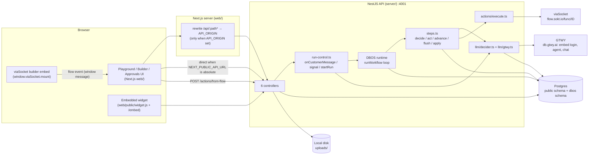

### 1.3 Source map (`server/src`)

| Path | Responsibility |
|---|---|
| [main.ts](../server/src/main.ts) | Boot: DBOS config + launch, then Nest app, body limit, CORS, listen |
| [app.module.ts](../server/src/app.module.ts) | Single module registering the 6 controllers (no providers or DI services) |
| [config.ts](../server/src/config.ts) | Env reads and limits; throws at import if required env is missing |
| [db.ts](../server/src/db.ts) | `pg` Pool (max 10) and the `q`, `one`, `tx` helpers |
| [types.ts](../server/src/types.ts) | Workflow tree/graph types, `Facts`, `WaitingFor`, `RunRow`, `Signal`, `ACTIVE`, built-in `VARIABLES` |
| [workflows/](../server/src/workflows) | Controller, service (CRUD/publish), tree validator, graph validator and conversion, tree utilities |
| [actions/](../server/src/actions) | Actions controller (CRUD, viaSocket flow ingestion), `execute.ts` (arg validation, idempotent execution) |
| [integrations/](../server/src/integrations) | viaSocket builder token, flow runner, legacy app-action runner, `{{args.x}}` templating |
| [llm/](../server/src/llm) | GTWY client (`gtwy.ts`) and all prompts and decisions (`decider.ts`) |
| [playground/](../server/src/playground) | Conversations, messages, attachments, AI-call traces, public widget API |
| [runner/](../server/src/runner) | DBOS workflow (`workflow.ts`), its steps (`steps.ts`), run control and signals (`run-control.ts`), context loading, Flow abstraction, input/rules helpers, events |
| [../migrations/](../server/migrations) | 10 SQL migrations (0001–0007, 0009–0011; there is no 0008) |
| [../scripts/setup-db.js](../server/scripts/setup-db.js) | Creates the DB if missing and applies migrations once each |

There are no NestJS providers, guards, interceptors, pipes or filters. Every controller calls plain module functions or SQL directly.

---

## 2. Bootstrap, configuration and infrastructure

### 2.1 Boot sequence (`server/src/main.ts:1-21`)

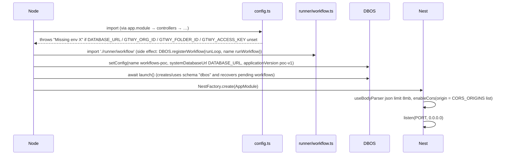

✅ Execution-order requirements:
1. `import './runner/workflow'` (`main.ts:7`) must run before `DBOS.launch()`, because a workflow must be registered before launch for recovery to find it. **[library behaviour]**
2. `DBOS.launch()` runs before the HTTP server listens, so recovered runs may already be executing when the first request arrives.
3. Module-level side effects at import time: `config.ts` validates env (`config.ts:2-3`). `db.ts` creates the Pool (`db.ts:4`). `playground.controller.ts` creates the uploads directory (`playground.controller.ts:9-10`).
4. Postgres migrations are **not** applied by `main.ts`. They run separately (`npm run db:setup`). On Render, `startCommand: npm run db:setup && npm start` (`render.yaml`).

DBOS recovery: on `launch()`, DBOS resumes workflows that were pending in this `applicationVersion` (`poc-v1`). Completed steps return their checkpointed output and only unfinished steps re-execute. **[library behaviour]** Changing `applicationVersion` would stop old in-flight runs from being recovered by the new code. **[library behaviour — verify with DBOS docs]**

### 2.2 Configuration (`server/src/config.ts:1-25` and direct `process.env` reads)

| Variable | Required | Default | Read in | Effect |
|---|---|---|---|---|
| `DATABASE_URL` | ✅ (throws) | — | `config.ts`, `setup-db.js` | App DB and DBOS system DB (same database, DBOS uses schema `dbos`) |
| `GTWY_ORG_ID` | ✅ | — | `config.gtwy.orgId` | Embed JWT claim `org_id` |
| `GTWY_FOLDER_ID` | ✅ | — | `config.gtwy.folderId` | Embed JWT claim `folder_id` |
| `GTWY_ACCESS_KEY` | ✅ | — | `config.gtwy.accessKey` | HMAC-SHA256 key for the embed JWT |
| `PORT` | | `4001` | `config.port` | HTTP port |
| `CORS_ORIGINS` | | `http://localhost:4000` | `config.corsOrigins` | Comma-separated allowed origins |
| `GTWY_DB_BASE_URL` | | `https://db.gtwy.ai` | `config.gtwy.dbBaseUrl` | Embed login and agent API base (trailing `/` stripped) |
| `GTWY_SERVICE` | | `openai` | `config.gtwy.service` | Agent service and `llm_usage.model` prefix |
| `GTWY_MODEL` | | `gpt-6-luna` | `config.gtwy.model` | Model for the agent and every chat call |
| `REMIND_AFTER_SEC` | | `120` | `config.remindAfterSec` | Reminder while waiting on the customer |
| `EXPIRE_AFTER_SEC` | | `600` | `config.expireAfterSec` | Run expires if the customer doesn't reply |
| `APPROVAL_TIMEOUT_SEC` | | `1800` | `config.approvalTimeoutSec` | `approval_task.due_at`; run escalates on timeout |
| `UPLOADS_DIR` | | `<cwd>/uploads` | `playground.controller.ts:9` | Attachment storage directory |
| `VIASOCKET_ORG_ID` / `VIASOCKET_PROJECT_ID` | | `''` | `integrations/viasocket.ts:7` | Builder token claims and SDK client |
| `VIASOCKET_EMBED_SECRET` | | `''` | same | HMAC key for the builder token. If empty, builder token and SDK throw "viaSocket is not configured" |
| `VIASOCKET_UID` | | `workflows-poc` | same | `user_id` / `unique_identifier` in the builder token |
| `POC_ENCRYPTION_KEY` | | `''` | `viasocket.ts:48` | AES-256-GCM key (hex) for legacy `app_connection.script_id_enc` |

Hard-coded limits (`config.ts:21-24`): `maxSteps 15` (tree), `maxDepth 2` (tree nesting), `maxVisits 100` (goto or edge repeat limit), `maxGraphSteps 50` (canvas). `config.gtwy.embedUserId = 'workflows-poc'`.

### 2.3 Database access helpers (`server/src/db.ts:1-27`)

| Helper | Behaviour |
|---|---|
| `pool` | `new Pool({ connectionString, max: 10 })` |
| `q(sql, params)` | `pool.query` and returns `rows` |
| `one(sql, params)` | First row or `null` |
| `tx(fn)` | Checks out a client, `begin` → `fn(client)` → `commit`. On throw: `rollback` and rethrow. Always `release()` |

There is no ORM or repository layer. All SQL is inline and parameterised (`$1…`). The only transactions in application code are `publishWorkflow` (`workflows.service.ts:59-66`) and the row-lock block in `executeAction` (`execute.ts:46-55`). `setup-db.js` wraps each migration in its own transaction.

### 2.4 Migrations runner (`server/scripts/setup-db.js:1-40`)

1. Parse `DATABASE_URL`. Try to connect to the `postgres` DB and `create database "<name>"` if it's missing. Any failure is logged as "skipping database creation", because managed Postgres may not allow it.
2. Connect to the target DB and `create table if not exists schema_migrations(name pk, applied_at)`.
3. For each `migrations/*.sql` in lexical order that isn't recorded: `begin` → execute file → insert name → `commit`. ⚠️ A failing migration throws before `commit`. The script exits with code 1 without an explicit `rollback`, and Postgres discards the open transaction when the connection closes.

### 2.5 Deployment (`render.yaml`)

- `workflows-poc-db` is a Render Postgres (free).
- `workflows-poc-api` (rootDir `server`): `npm ci && npm run build`, start `npm run db:setup && npm start`, **healthCheckPath `/actions`**. A health check therefore runs `select * from action`.
- `workflows-poc-web` (rootDir `web`): `API_ORIGIN` points at the API service and `NEXT_PUBLIC_API_URL=/api`, so browser calls go through the Next rewrite (§14).
- Secrets with `sync: false`: GTWY org/folder/key, viaSocket org/project/secret, `POC_ENCRYPTION_KEY`.
- ⚠️ `uploads/` sits on local disk. On a Render web service without a persistent disk, files are lost on redeploy or restart while `attachment.path` rows remain (see §13 and §17). **[unverified: whether a disk is attached in the Render dashboard]**

---

## 3. Cross-cutting concerns

| Concern | Implementation | Evidence |
|---|---|---|
| **Authentication** | **None.** No guards, middleware or tokens on any route. The README says so too ("no auth") | `app.module.ts`, all controllers |
| **Authorization** | None. `by`/`decided_by` come from the request body (default `'teammate'` / `'Team'`) | `runs.controller.ts:13,37-39` |
| **CORS** | `app.enableCors({ origin: config.corsOrigins })`. Only restricts browsers | `main.ts:16` |
| **Body size** | JSON bodies up to 8 MB (base64 attachments ≤ 5 MB decoded) | `main.ts:15`, `playground.controller.ts:85` |
| **Validation** | No `ValidationPipe` or DTO classes. Each handler checks fields by hand and throws `BadRequestException`. Workflow content goes through `validateWorkflow`/`validateGraph`. Action args go through `validateArgs` | see each endpoint |
| **Error mapping** | Nest's built-in exception filter **[library behaviour]**: `BadRequestException` → 400, `NotFoundException` → 404, `ConflictException` → 409. Any other thrown error (pg errors such as invalid UUID `22P02` or FK violation `23503`) → **500** `{statusCode:500,message:"Internal server error"}` | — |
| **Success codes** | Nest defaults **[library behaviour]**: `@Post` → 201, others → 200. No `@HttpCode` overrides | all controllers |
| **Structured audit log** | `run_event` rows via `addEvent()` (`runner/events.ts:4-6`) and `action_run` rows | §4 |
| **AI telemetry** | One `llm_usage` row per GTWY call, holding the full request/response, tokens, cost and latency (`llm/gtwy.ts:87-97`). Failures to record are only `console.warn`ed | §10 |
| **App logging** | `console.log` at boot. Nest `Logger('RunControl')` warns on duplicate active runs and failed topic checks (`run-control.ts:12,99,124`) | — |
| **Metrics / tracing** | No metrics library and no OpenTelemetry. GTWY thread/sub-thread ids (`traceFor`) act as the trace correlation for AI calls. DBOS's step history is exposed through `GET /runs/:id/dbos-steps` | — |
| **Feature flags** | None. Behaviour depends on env (§2.2), `workflow.enabled`, `action.enabled`, `action.requires_approval` | — |
| **Caching** | Process memory only: the GTWY session token (refreshed 60 s before `exp`), the GTWY agent id and the viaSocket SDK client. There is no invalidation besides the 401 retry. `app_setting.gtwy_agent_id` persists the agent id | `gtwy.ts:8-9,20-42`, `viasocket.ts:8-12` |

---

## 4. Data model

### 4.1 ER diagram (after all migrations)

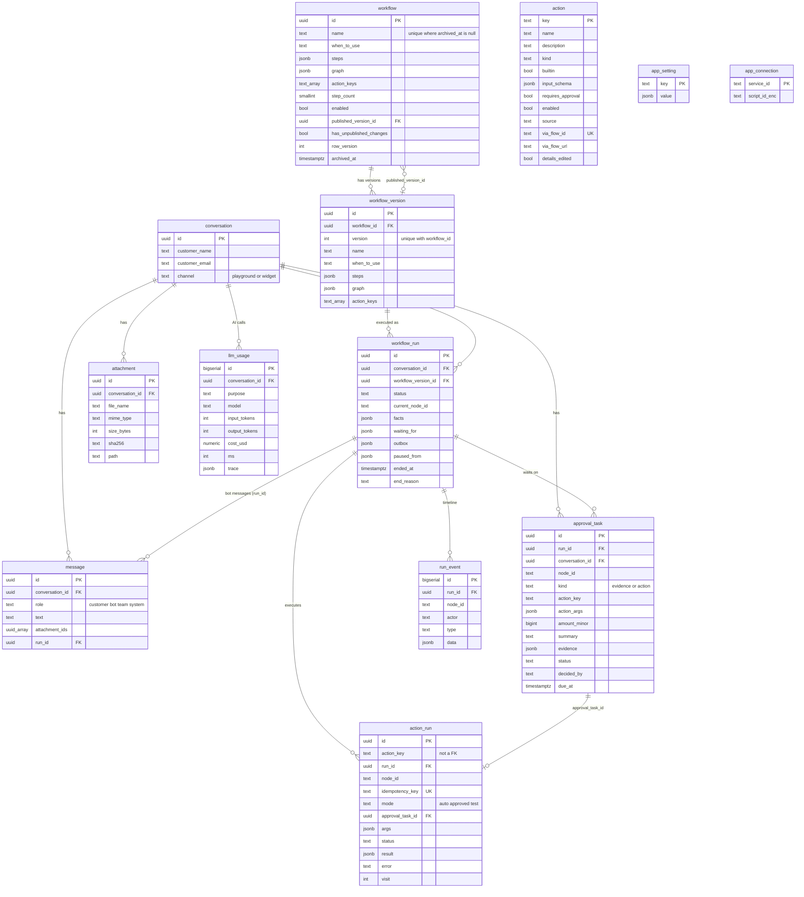

`action` is referenced by **text key only**: `workflow.action_keys`, `workflow_version.action_keys`, `action_run.action_key` and `approval_task.action_key`. There is no FK. Renames and deletes are guarded in application code (§5.2).

### 4.2 Tables: constraints, indexes, writers and readers

| Table | Key constraints and indexes (migration) | Written by | Read by |
|---|---|---|---|
| `app_setting` | PK `key` (0001) | `ensureAgent` upsert `gtwy_agent_id` (`gtwy.ts:40`) | `ensureAgent` (`gtwy.ts:32`) |
| `action` | PK `key` with check `^[a-z][a-z0-9_]{1,47}$`. `kind in (read,write)`. `source in (builtin,mock,viasocket,viasocket_flow)` default `viasocket_flow` (0002/0005/0009). `via_flow_id` **unique** (0005) | `ActionsController.patch/remove/fromFlow`, migrations | `getAction`, `enabledActionKeys`, `GET /actions*`, runner `decide`/`act`/`apply` |
| `workflow` | Partial unique index `workflow_name_active(name) where archived_at is null` (0003). FK `published_version_id` | `workflows.service.ts` create/save/publish/patch/archive. 0009 archives workflows that used the mock actions | service, `onCustomerMessage`/`switchedTopic` (routing list), `ActionsController` usage checks |
| `workflow_version` | `unique(workflow_id, version)`. FK `workflow_id` | `publishWorkflow` (tx) | `loadRun`, `startRun`, playground `GET /conversations/:id`, approvals list, action rename check |
| `conversation` | `channel in (playground,widget)` default `playground` (0004) | `POST /conversations`, `POST /widget/conversations` | everywhere a run or message is built |
| `message` | `role in (customer,bot,team,system)` (0004). Index `(conversation_id, created_at)`. FK `run_id` | `postCustomerMessage`, `teamSend`, `onCustomerMessage` (system/bot), `switchedTopic` (system), `flush` (bot + run_id), error catch in `postCustomerMessage` (system) | `loadTranscript` (excludes `system`), playground/widget GETs |
| `attachment` | FK conversation (cascade) | `POST /attachments` (insert, then update `path`) | `GET /attachments/:id`, message joins, approvals list |
| `workflow_run` | `status` check (9 values, 0004). **Partial unique index `workflow_run_one_active(conversation_id) where status in (running, waiting_customer, waiting_approval, paused, failed)`** (0004) | `startRun` (insert), `saveRun` (full-row update), `flush` (outbox clear), `markNotAnswer` (facts merge) | `loadRun`, `signal`, `onCustomerMessage`, playground/widget GETs |
| `approval_task` | `kind in (evidence, action)`. `status in (pending, approved, rejected, expired, cancelled)`. **Partial unique `(run_id, node_id) where status='pending'`** | `openTask` (insert), `POST /approvals/:id/decide` (pending→approved/rejected), `apply` end (→cancelled), approval timeout (→expired) | `advance`, `apply`, `GET /approvals`, playground GET |
| `action_run` | **`idempotency_key` unique**. `mode in (auto,approved,test)`. `status in (running,succeeded,failed)`. `visit int default 1` (0004) | `executeAction` | `executeAction`, `GET /actions/:key/sample`, playground GET |
| `run_event` | Index `(run_id, id)` | `addEvent` (append-only) | playground GET (newest 500 across all runs of the conversation) |
| `llm_usage` | Index `(conversation_id, id)`. FK conversation (cascade) | `recordUsage` | playground GET, `GET /ai-calls/:id` |
| `app_connection` | PK `service_id` (0002) | **nothing in current code** (legacy) | `runAppAction` (legacy `source='viasocket'` actions) |
| `schema_migrations` | PK `name` | `setup-db.js` | `setup-db.js` |
| `dbos.*` | Managed by DBOS (workflow status, step outputs, notifications) **[library behaviour; table names unverified]** | DBOS runtime (`runStep`, `send`, `recv`, `startWorkflow`) | DBOS recovery, `DBOS.listWorkflowSteps` |

Unused columns: `workflow.template`, `action.kind` (always `'write'` for new flows), `action.builtin`, `action_run.mode='test'`, `action.input_template` / `via_*` (legacy app actions).

### 4.3 Migration history

| File | Change |
|---|---|
| `0001_init.sql` | All core tables, mock `shop_order`, seed actions `lookup_order`, `refund_order` (mock), `request_approval`, `escalate_to_human` (builtin) |
| `0002_viasocket.sql` | `app_connection`. `action.source` and `via_*` columns. `input_template` |
| `0003_workflow_name_active.sql` | Name unique only among non-archived workflows |
| `0004_plan_alignment.sql` | `requires_approval` replaces autonomy/limits/teams. `waiting_team`→`waiting_approval`. `facts.visits`. `action_run.visit` (drops `policy`). `team` role. `conversation.channel` |
| `0005_viasocket_flows.sql` | `source='viasocket_flow'`. `via_flow_id` (unique), `via_flow_url` |
| `0006_action_details_edited.sql` | `details_edited` |
| `0007_workflow_graph.sql` | `graph jsonb` on `workflow` and `workflow_version` |
| *(0008 missing)* | **[unverified]**: no file. The runner applies files by name, so a missing number does nothing |
| `0009_remove_mock_shop.sql` | Archives and disables workflows that used `lookup_order`/`refund_order`. Deletes `source='mock'` actions. Drops `shop_order` |
| `0010_llm_usage.sql` | `llm_usage` table |
| `0011_llm_usage_trace.sql` | `llm_usage.started_at`, `trace` |

### 4.4 JSON column shapes (`server/src/types.ts`)

**`workflow.steps` / `workflow_version.steps` (tree form):** `WorkflowNode[]` where
- `StepNode {id, type:'step', content: Inline[], save?: SaveField[]}`
- `BranchNode {id, type:'branch', mode?: 'ai'|'rules', cases: BranchCase[]}`. `BranchCase {id, kind:'if'|'else_if'|'else', condition: Inline[], steps: WorkflowNode[], rules?: Rule[], join?: 'and'|'or'}`
- `GotoNode {id, type:'goto', target, max_visits, fresh?}`
- `Inline = {t:'text',v} | {t:'action',key} | {t:'var',key}`

**`workflow.graph` (canvas form):** `WorkflowGraph {start, groups: GraphGroup[], edges: GraphEdge[], variables?: string[]}`. A group has `items` of type `step | bubble | input{prompt,saveAs,format,retry?} | condition{mode?,cases}`. An edge is `{from:{groupId,itemId?,port?}, to:{groupId,itemId?}, maxVisits?, fresh?}`. When `graph` is non-null it is the workflow and `steps` is ignored (`workflows.service.ts:8-9`, `flow.ts:68`).

**`workflow_run.facts` (`Facts`, `types.ts:69-84`):** the run's whole memory.

| Key | Meaning | Written in |
|---|---|---|
| `collected` | Values the LLM extracted. Seeded with `customer_name`, `email` | `startRun`, `advance` (step decisions) |
| `outputs[nodeId]` | Action result, `{approval_task_id}` while pending, `{approved,reviewed_by,reviewer_note}`, or an input answer | `advance`, `apply` |
| `cases[nodeId]` | `{case_id, reason}` for a decided branch | `advance` |
| `attempts[nodeId]` / `attempts['!'+nodeId]` | ask-customer / input re-ask counter, and the invalid-action counter | `advance`, `follow` (reset), `apply` retry (reset `!`) |
| `visits[gotoOrEdgeId]` | Visit number of a jump target | `rerun` |
| `since[nodeId]` | `{at, fresh}` marker inserted into the transcript for re-run steps | `rerun` |
| `previous[nodeId]` | Output before the last jump back | `rerun` |
| `collectedBy`, `varsBy` | Which keys or vars a node filled (for "ask again" clearing) | `advance`, `saveResponse` |
| `vars` | Workflow variables (input answers, "Save response") | `advance` (ask), `saveResponse` |
| `asked[inputId]` | ISO time the input block last asked | `advance` |
| `toolError[stepId]` | Last tool failure, shown to the LLM on its one retry | `advance` |
| `notAnswer[inputId]` | Topic check said the reply is not an answer | `markNotAnswer` |
| `trail` | Canvas: finished item ids in order (loop detection) | `follow` |

**`waiting_for`:** `{type:'customer', node_id, expects[], remind_at, expires_at, reminded}` or `{type:'approval', node_id, task_id, due_at}` (epoch ms).
**`outbox`:** `(string | {text, verbatim:true, nodeId?})[]`. Strings are AI notes that get merged. Objects are sent word for word.
**`paused_from`:** `{status, waiting_for}` captured on pause.

---

## 5. API reference

All routes have **no authentication**. The base URL is `http://localhost:4001` in dev, or `/api/*` through the Next proxy in deploy. 31 endpoints in total.

### 5.1 Workflows module

Controller: `server/src/workflows/workflows.controller.ts:5-16`. Service: `server/src/workflows/workflows.service.ts`.

Shared internals:
- `check(w, enabled)` (`service:8-9`) → `validateGraph` if `w.graph`, else `validateWorkflow` (§8).
- `enabledActionKeys()` (`service:11`) → `select key from action where enabled`.
- `getWorkflow(id)` (`service:20-26`) is the read model returned by most endpoints: `workflow.* + published_version` (joined version number) + `validation: {issues, action_keys, step_count}` computed live.

#### `GET /workflows`
- **Purpose:** list non-archived workflows. **Handler:** `list()` → `listWorkflows()` (`service:13-18`).
- **SQL:** `workflow w left join workflow_version v on v.id = w.published_version_id where w.archived_at is null order by w.created_at`.
- **Response 200:** `[{id, name, when_to_use, enabled, step_count, has_unpublished_changes, updated_at, published_version}]`.

#### `GET /variables`
- **Purpose:** the built-in `{{variables}}` (`types.ts:111-115`): `customer.name`, `customer.email`, `today`. Static, no DB.
- The web client also uses it as a cheap wake-up probe (`web/src/lib/api.ts`, §14).

#### `POST /workflows`
- **Body:** `{name?: string}`. **Handler:** `createWorkflow` (`service:28-38`).
- **Sequence:**
  1. `base = name.trim() || 'Untitled workflow'`.
  2. `select name from workflow where name like base% and archived_at is null`. If `base` itself is taken, the name becomes `${base} ${count+1}`.
  3. Steps = one empty step `{id: rid(), type:'step', content: []}` (`rid` = 8 random base-36 chars, `service:89-91`).
  4. `validateWorkflow` gives the `action_keys` and `step_count` columns. Issues are not stored.
  5. Insert the workflow (defaults: `enabled=false`, `has_unpublished_changes=true`, `row_version=1`). Return `getWorkflow(id)`.
- **Response 201:** the workflow read model. A new workflow's `validation.issues` includes "Step 1 is empty".
- **Errors:** ⚠️ the suffix logic counts every name that starts with `base`, so the computed name can still collide → unique-index violation → **500**. `%`/`_` in `name` act as LIKE wildcards.

#### `GET /workflows/:id`
- `getWorkflow(id)`. **404** `workflow not found` if missing or archived. ⚠️ A non-UUID id → pg `22P02` → **500**.

#### `PUT /workflows/:id` — save draft
- **Body:** `{name, when_to_use, steps?, graph?, row_version}`. **Handler:** `saveWorkflow` (`service:40-53`).
- **Validation:** `name.trim()` is required (**400**). Content is validated but **issues don't block saving**. Drafts save with issues.
- **Sequence:**
  1. Load the current `steps, graph` (no archived filter). **404** if absent.
  2. `next = {steps: body.steps ?? cur.steps, graph: body.graph ?? cur.graph}`. ⚠️ `graph: null` can't clear a graph, because `??` falls back to the current one. Once a workflow is a canvas it stays a canvas.
  3. `check(next, enabledActionKeys)` gives `action_keys` and `step_count`.
  4. **Optimistic lock:** `update … set …, has_unpublished_changes=true, row_version=row_version+1 where id=$1 and row_version=$8 and archived_at is null returning id`.
  5. No row → **409** "This workflow changed elsewhere — reload…". This also happens if the workflow is archived or `row_version` is missing.
  6. Return `getWorkflow(id)`.
- **Side effects:** none beyond the row. Running runs keep their `workflow_version`.

#### `POST /workflows/:id/publish`
- **Handler:** `publishWorkflow` (`service:56-68`).
- **Sequence:**

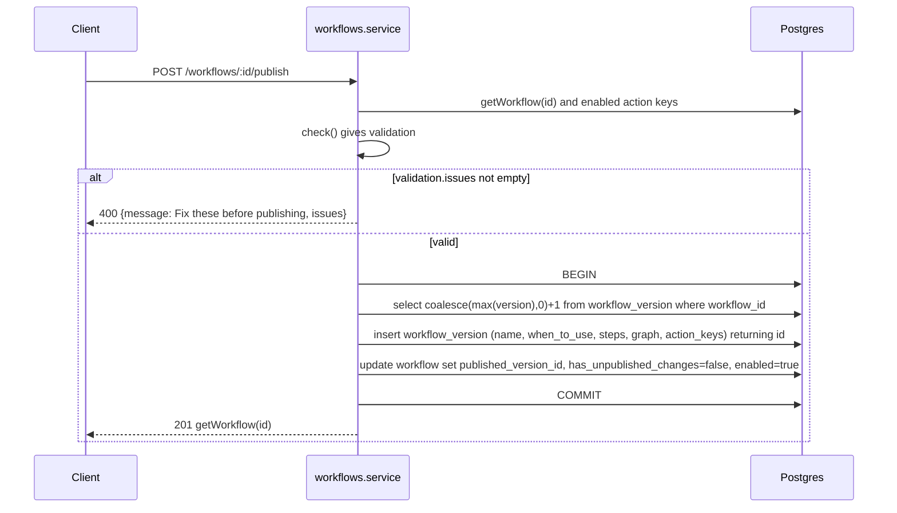
- **Effects:** new runs started after this use the new version. Active runs keep theirs (`workflow_run.workflow_version_id`). Publishing **always enables** the workflow.
- ⚠️ Two concurrent publishes can compute the same `version`. The `unique(workflow_id,version)` constraint makes one fail → **500**.
- ⚠️ Routing reads `name` and `when_to_use` from the **draft `workflow` row**, not from the published version (§6.2). Editing "When to use" changes routing immediately, without publishing.

#### `POST /workflows/:id/canvas` — convert tree → graph
- **Handler:** `toCanvas` (`service:71-75`). If `graph` is already set, it returns the workflow unchanged. Otherwise it calls `saveWorkflow(id, {name, when_to_use, graph: treeToGraph(steps), row_version})` (§8.3). Item ids are preserved, so old `facts` and history still line up. Published versions are not changed.

#### `PATCH /workflows/:id`
- **Body:** `{enabled?: boolean}`. **Handler:** `patchWorkflow` (`service:77-82`).
- `enabled:true` without a published version → **400** "Publish the workflow before enabling it". Then `update workflow set enabled = coalesce($2, enabled)`. **404** via `getWorkflow` if missing or archived.

#### `DELETE /workflows/:id` — archive
- **Handler:** `archiveWorkflow` (`service:84-87`): `update workflow set archived_at = now(), enabled = false`. Returns `{ok:true}` even if the id doesn't exist (no 404). This is a soft delete. Versions and runs stay.

### 5.2 Actions module

Controller: `server/src/actions/actions.controller.ts:30-110`.

#### `GET /actions`
`select * from action order by source, created_at, key`. ⚠️ This returns `via_flow_url`, which migration 0005 describes as "treat like a credential", to any caller.

#### `GET /actions/:key/sample`
- **Purpose:** the newest successful result of an action, so the editor can offer fields for "Save response".
- **SQL:** `action_run where action_key=$1 and status='succeeded' and result is not null order by finished_at desc nulls last limit 1`.
- **Response:** `{result|null, at|null}`.

#### `GET /actions/:key`
The action row, or **404**.

#### `PATCH /actions/:key`
- **Body:** `{enabled?, requires_approval?, new_key?, name?, description?}`. **Handler:** `patch` (`:50-70`).
- **Sequence:**
  1. `this.get(key)` (**404** if missing).
  2. If `new_key` differs: regex `^[a-z][a-z0-9_]{1,47}$` (**400**). Must not exist (**400**). **Must not be used** by any non-archived workflow (`action_keys`) **or by any `workflow_version`** (**400** listing the names). This is because steps embed the key in `Inline` content.
  3. `name`/`description`, if provided, must be non-blank (**400**).
  4. A single `update action set enabled = coalesce(..), requires_approval = coalesce(..), name, description, details_edited = details_edited or <name/description provided>, key = coalesce(new_key, key)`.
  5. Return the updated row.
- **Coupling:** once `details_edited` is true, later viaSocket updates no longer overwrite name or description (§11).
- **Runtime effect:** setting `enabled=false` makes the runner treat the action as unavailable: `decide` filters it out of `allowed`, and `act` returns `invalid` "… is disabled". `requires_approval` is read at `act` time, so it applies to the next call, including in running runs.

#### `DELETE /actions/:key`
- **400** if any non-archived workflow's `action_keys` contains the key. Then `delete from action where key=$1 and source in ('viasocket','viasocket_flow')`. Builtins are silently kept. Response `{ok:true}`.
- ⚠️ It does not check `workflow_version`. A published version of an *archived* workflow may still reference the key, but archived workflows are not routable, so the risk is limited to active runs of an archived workflow. Those runs hit `invalid` (§7.4).

#### `POST /actions/from-flow` — viaSocket flow event ingestion
- **Trigger:** the browser's viaSocket builder emits `flow` events. `web/src/components/viasocket-panel.tsx:84-86` forwards `published | updated | paused | deleted | delete` events that carry a `webhookurl`.
- **Body (`FlowEvent`, `:6-11`):** `{id, action?, status?, title?, description?, webhookurl?, payload?, openaiToolJson?.function{name,description,parameters}, mcpToolJson?.inputSchema}`.
- **Validation:** `id` is required and `webhookurl` must match `^https://flow\.sokt\.io/func/[A-Za-z0-9_-]+$`. Otherwise **400** "not a viaSocket flow event". This is the only check. No signature verification (see §17).
- **Sequence:**

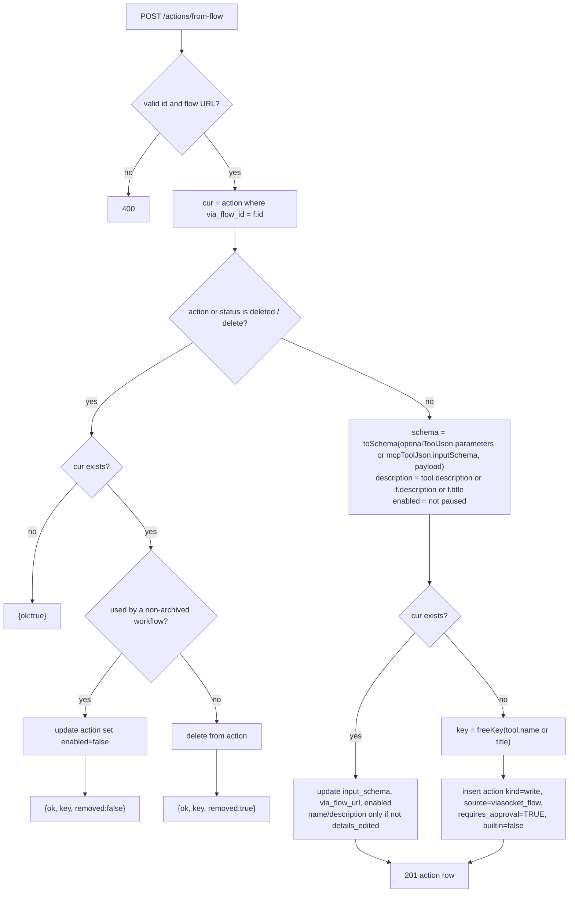
- `toSchema` (`:14-18`): uses the tool's `properties`. If there are none, it infers `{type: number|string}` from the sample `payload` values. `required` is filtered to keys that exist.
- `freeKey` (`:21-28`): slugifies to `[a-z0-9_]`, strips leading non-letters and trailing `_`, caps at 40 chars, prefixes `flow_` if shorter than 2, then appends `_2`, `_3`… until unused. One query per candidate.
- **Security default:** new tools always start with `requires_approval = true` (`:104-107`).

### 5.3 Integrations module

#### `GET /integrations/builder-token`
- **Handler:** `integrations.controller.ts:9` → `builderToken()` (`integrations/viasocket.ts:16-22`).
- Builds an HS256 JWT by hand: header `{alg:HS256,typ:JWT}`, payload `{org_id, project_id, user_id: VIASOCKET_UID, unique_identifier: VIASOCKET_UID}`, signed with `VIASOCKET_EMBED_SECRET`. ⚠️ No `exp` or `iat` claim, so tokens never expire unless viaSocket enforces something itself. **[unverified]**
- **Response 200:** `{token}`. **400** (wrapped by `fail`) if the secret is not configured.
- ⚠️ Unauthenticated: anyone who can reach the API can mint a builder token for the POC's viaSocket end user.

### 5.4 Playground module

Controller: `server/src/playground/playground.controller.ts:12-102`. Shared message entry: `playground/conversations.ts:6-14`.

#### `GET /conversations`
All conversations (both channels) with correlated subqueries: latest run `run_status`, the latest non-system `last_text`, and the `pending_approvals` count. Ordered by `created_at desc`. Polled by the Playground every 1.5 s (§14).

#### `POST /conversations`
- **Body:** `{customer_name?, customer_email?}`. Defaults are `'Alex Kim'` / `'alex@example.com'`. Inserts with `channel='playground'`. **201** with the row.

#### `GET /ai-calls/:id`
One `llm_usage` row with its full `trace` (the request sent to GTWY and its raw reply). `where id::text = $1` avoids cast errors. `cost_usd::text` keeps the exact decimal. **404** if missing.

#### `GET /conversations/:id` — the Playground's single poll
- **Handler:** `get` (`:38-68`). Polled every 1.5 s.
- **Queries, in order:**
  1. conversation (**404** if missing)
  2. messages with aggregated attachments (`left join attachment on a.id = any(m.attachment_ids)`, `json_agg … filter`), including `system` messages
  3. all runs of the conversation joined with `workflow_version` (`name, version, steps, graph`), newest first
  4. `run_event` for **all** those runs, newest 500, re-sorted ascending
  5. all `approval_task` rows of the conversation
  6. `action_run` rows for the **latest run only**
  7. all `llm_usage` rows (without `trace`)
  8. `sum(cost_usd)::text`
- **Response:** `{conversation, messages, runs, events, approvals, action_runs, ai_usage:{calls,count,input_tokens,output_tokens,cost_usd,no_cost}}`. Tokens are summed in JS. Cost is summed in Postgres numeric and returned as text.

#### `POST /conversations/:id/messages` — customer message (playground)
- **Body:** `{text?, attachment_ids?: uuid[]}`. **Handler:** `send` → `postCustomerMessage(id, b)`.
- **Sequence (synchronous part):**
  1. Both text and attachments empty → **400** "empty message".
  2. `insert into message (conversation_id, role='customer', text, attachment_ids) returning *`. ⚠️ The conversation's existence isn't checked. An unknown id → FK violation → **500**.
  3. **Fire-and-forget** `onCustomerMessage(conversationId, m.id)` (§6). It is not awaited. On rejection, a `system` message `Error: <message>` is inserted.
  4. **201** with the message row.
- **Asynchronous part:** routing, topic check or signal delivery (§6). The UI sees the results by polling.

#### `POST /conversations/:id/team-messages`
- **Body:** `{text}`. **400** if empty. Inserts `role='team'`. **Does not wake the run** (comment at `:75`). Team messages appear in the LLM transcript as `Teammate:` on the run's next decision (`decider.ts:27`).

#### `POST /attachments`
- **Body:** `{conversation_id, file_name, mime_type, data_base64}`. **Handler:** `upload` (`:82-93`).
- **Sequence:** decode base64. Size must be 1 B–5,000,000 B (**400**). Insert a row with the computed `sha256` and `path=''` → `writeFileSync(UPLOADS/<id>)` → update `path` → **201** `{id, file_name, mime_type}`.
- **Not validated:** `mime_type`, `file_name`, or whether `conversation_id` exists (bad id → FK error → **500**). The insert, file write and update aren't atomic: a crash between them leaves a row with `path=''`.
- Attachments are linked to a message only when the client later passes `attachment_ids` in a message.

#### `GET /attachments/:id`
- `select * from attachment`. **404** if missing. Sets `Content-Type` to the **stored client-supplied** `mime_type` and pipes `createReadStream(path)` to the Express response (`@Res()` bypasses Nest serialisation).
- ⚠️ No error handler on the read stream. If the file is missing on disk (ephemeral disk, manual cleanup), the stream emits an unhandled `'error'`. In Node that becomes an uncaught exception that can take the process down. **[library behaviour — Node EventEmitter semantics]**
- ⚠️ Serving a user-chosen MIME type (for example `text/html`) from the API origin lets anyone upload content that renders as active content. No `Content-Disposition` header is set.

### 5.5 Widget module

Controller: `server/src/playground/widget.controller.ts:6-37`. This is the public surface for the embeddable chat. It deliberately exposes only customer-visible data. The conversation UUID is the only secret.

#### `POST /widget/conversations`
- **Body:** `{name?, email}`. `email` must contain `@` (**400**). Inserts `channel='widget'`, with `name` defaulting to the email's local part and the email lowercased. **201** `{id, customer_name}`.

#### `GET /widget/conversations/:id`
- **404** unless the conversation exists **and** `channel='widget'`. That stops widget callers from reading playground conversations.
- Returns non-system messages with attachments, plus:
  - `typing` = the last message is from the customer **and** the latest run status is not in `waiting_approval | escalated | paused`. This is a heuristic for "the bot owes a reply".
  - `waiting_approval` = latest run status is `waiting_approval`.
- Polled every 1.5 s by `/embed` (`web/src/app/embed/page.tsx:42`).

#### `POST /widget/conversations/:id/messages`
- **404** unless it's a widget conversation. Then the **same pipeline** as §5.4 (`postCustomerMessage`). The response only exposes `{id}`.

### 5.6 Runs and approvals module

Controller: `server/src/runner/runs.controller.ts:6-44`.

#### `POST /runs/:id/:op` — teammate run controls
- **Params:** `op ∈ {pause, resume, cancel, retry}` → signal type `pause | resume | cancel | retry_step`. Anything else → **400** "unknown operation". **Body:** `{by?}` (default `'teammate'`).
- **Sequence:** `signal(id, {type, by}, idempotencyKey = "<op>:<id>:<Date.now()>")` (§7.6):
  1. Load the run status. **400** "run not found" if missing.
  2. **400** `"<type>" is not allowed while the run is <status>` per the `ALLOWED` matrix.
  3. `addEvent(run, null, 'user:<by>', 'signal', s)`.
  4. `DBOS.send('run:<id>', s, 'signal', key)`.
- **Response 201** `{ok:true}`. The actual state change happens **asynchronously** when the DBOS loop `recv`s the signal and runs `apply` (§7.5).
- ⚠️ The idempotency key includes `Date.now()`, so a double-click delivers two signals. The state machine makes most duplicates harmless (for example, `resume` on a non-paused run → `waitAgain`).

#### `GET /runs/:id/dbos-steps`
`DBOS.listWorkflowSteps('run:<id>')` mapped to `{function_id, name, error, output, started_at, completed_at}`. This is the engineering view of checkpoints.

#### `GET /approvals?status=pending|approved|rejected|expired|cancelled|all`
- Default `pending`. `all` disables the filter. Joins conversation (customer name and email) and run → version (`workflow_name`). It also aggregates attachments whose ids appear in `evidence.attachment_ids` (jsonb array). Newest first. Polled every 3 s by `/approvals` and the nav (§14).

#### `POST /approvals/:id/decide`
- **Body:** `{approved: boolean, note?, by?}`. **Handler:** `decide` (`:35-43`).
- **Sequence:**
  1. **Atomic claim:** `update approval_task set status = approved|rejected, decided_by = coalesce(by,'Team'), decided_at = now(), decision_note where id=$1 and status='pending' returning *`. No row → **404** "task not pending". This makes double-decides safe.
  2. `signal(task.run_id, {type:'approval_decision', taskId, approved, by, note}, "task:<id>")`.
  3. **201** with the task row.
- ⚠️ Steps 1 and 2 are **not atomic**. If `signal` rejects (for example, the run is `paused`, which doesn't accept `approval_decision`), the HTTP call returns **400** but the task stays approved or rejected, and the run never learns about it. See §17 R1.
- The action itself runs **inside the DBOS loop** (`apply`), not in this request (§12).

---

## 6. Core flow: customer message → routing → run

### 6.1 End-to-end sequence

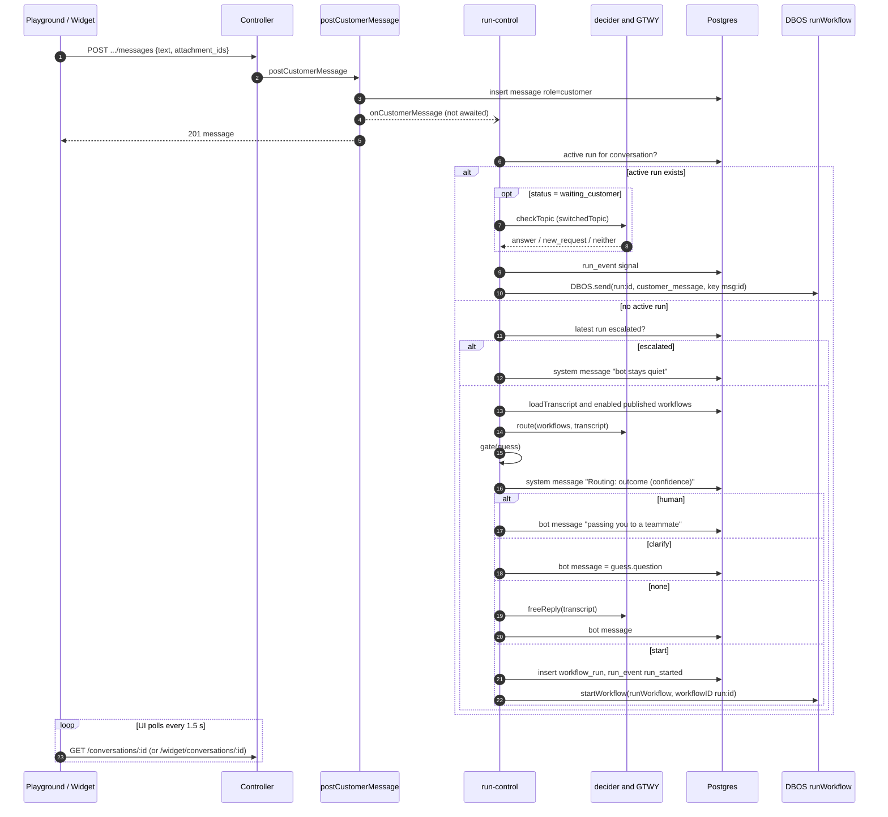

### 6.2 `onCustomerMessage(conversationId, messageId)` (`run-control.ts:34-61`)

| # | Step | Detail |
|---|---|---|
| 1 | Find active run | `status = any(ACTIVE)` where `ACTIVE = running, waiting_customer, waiting_approval, paused, failed` (`types.ts:67`). This matches the partial unique index |
| 2 | Active, `waiting_customer` | `switchedTopic()` (§6.3). If it returns `'switched'`, stop. Otherwise fall through |
| 3 | Active (any) | `signal(runId, {type:'customer_message', messageId}, "msg:<messageId>")`. All ACTIVE statuses allow `customer_message` |
| 4 | No active run, last run `escalated` | Insert a `system` message "Escalated to a human: the bot stays quiet…" and return. ⚠️ This is permanent for the conversation, because no code path un-escalates |
| 5 | Route | `loadTranscript` (non-system messages with attachments). Routable workflows = `enabled and archived_at is null and published_version_id is not null`, using **draft** `name`/`when_to_use` plus `published_version_id`. Call `route(..., traceFor(conv,'route',shortId(msg)))` |
| 6 | Gate | `gate()` (`decider.ts:105-110`): `wants_human ≥ 0.8` → `human`. Else `workflow_id && confidence ≥ 0.7` → `start`. Else `workflow_id && confidence ≥ 0.4 && question` → `clarify`. Else → `none` |
| 7 | Record | `system` message `Routing: <outcome> (confidence x.xx). <reason>` |
| 8 | Act | `human` → fixed bot text (no run, no escalation record). `clarify` → bot sends `question`. `none` → `freeReply` (an LLM call) as a bot message. `start` → `startRun(conv, version_id, reason)` |

Errors anywhere in this async function (GTWY failure, DB error, `signal` 400) are caught by `postCustomerMessage` and written as a `system` message `Error: …` (`conversations.ts:10-12`).

⚠️ The `human` outcome writes a message only. No run is created, so the next customer message is routed again from scratch.

### 6.3 Topic switch: `switchedTopic(conversationId, runId, messageId)` (`run-control.ts:69-102`)

Only runs when the active run is `waiting_customer`. Any exception → `log.warn` and `'pass'` (the message goes to the current run).

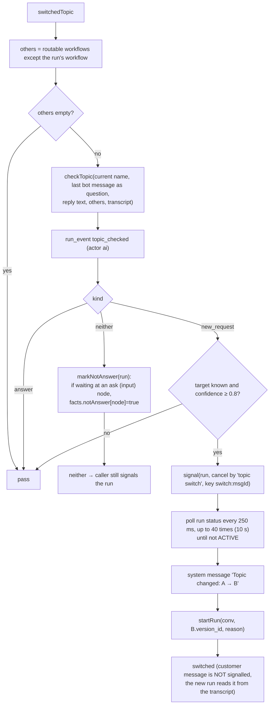

- `checkTopic` (`decider.ts:144-158`) returns `answer` straight away without an LLM call if there are no other workflows. Unknown `kind` → `answer`. `new_request` with an unknown workflow id → `neither`.
- `markNotAnswer` (`run-control.ts:105-112`) does a jsonb merge on `facts.notAnswer` with a direct UPDATE outside any DBOS step. The comment assumes the loop is parked in `recv()` (see §17 R5).
- ⚠️ If the cancelled run is still ACTIVE after 10 s, `startRun` hits the unique index (`23505`), logs "run already active", and returns `undefined`. `switchedTopic` still returns `'switched'`, so the customer message reaches neither run (§17 R3).

### 6.4 `startRun(conversationId, versionId, reason)` (`run-control.ts:114-130`)

1. Load the version (`steps, graph, name, version`) and the conversation.
2. Seed `facts = {collected: {customer_name, email}, outputs:{}, cases:{}, attempts:{}, visits:{}}`, because the sender's identity is known up front.
3. `insert workflow_run (conversation_id, workflow_version_id, current_node_id = flowOf(v).first(), facts)`. Status defaults to `running`. On `23505` (another active run exists) → warn and return.
4. `addEvent(run, null, 'system', 'run_started', {workflow, version, reason})`.
5. `DBOS.startWorkflow(runWorkflow, {workflowID: 'run:<id>'})(id)`. The DBOS workflow id is deterministic, so starting the same id twice is idempotent. **[library behaviour]**

⚠️ If `startWorkflow` throws after the insert, the `workflow_run` row is ACTIVE with no loop behind it. Every later message for the conversation is signalled to a workflow that doesn't exist (§17 R4).

---

## 7. The durable runner (DBOS)

### 7.1 The loop (`server/src/runner/workflow.ts:6-30`)

`runWorkflow = DBOS.registerWorkflow(runLoop, {name:'runWorkflow'})`. The loop is deterministic: it branches only on checkpointed step results. Each `DBOS.runStep(fn, {name})` result is stored. On replay after a crash, completed steps return their stored value without re-executing. **[library behaviour]** No retry options are passed to `runStep`, so DBOS defaults apply. **[unverified: DBOS 5 default retry policy for `runStep`]**

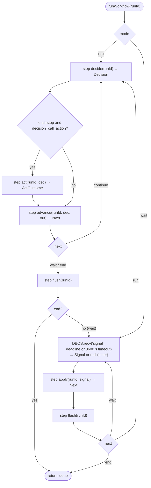

Step names that appear in `GET /runs/:id/dbos-steps`: `decide`, `act`, `advance`, `flush`, `apply`, plus DBOS's own `recv` entries. **[library behaviour]**

The outbox pattern: `advance` and `apply` never write chat messages directly. They push to `workflow_run.outbox` in the same UPDATE as the state change (`saveRun`), and the `flush` step later turns the outbox into `message` rows. If the process crashes between the two, replay still sends the reply.

### 7.2 Run context (`server/src/runner/context.ts`)

- `loadRun(runId)` (`:7-22`) reads everything fresh every step: the run row, the version (`name, version, steps, graph, workflow_id`), the conversation, the transcript, and `vars = {customer.name, customer.email, today (UTC date)} + graph.variables` filled from `facts.vars` (or legacy `facts.collected`). Objects are JSON-stringified. It returns `{run, version, flow: flowOf(version), messages, vars}`.
- `loadTranscript(conversationId)` (`:24-30`): messages excluding `system`, with `[{id,file_name}]` attachments, ordered by time.
- `saveRun(runId, run)` (`:32-38`): **full overwrite** of `status, current_node_id, facts, waiting_for, outbox, paused_from`, plus `updated_at`. If `ended`, it also sets `ended_at=now()`. `end_reason` is set when given.

### 7.3 `decide(runId)` — what to do at the current node (`steps.ts:36-94`)

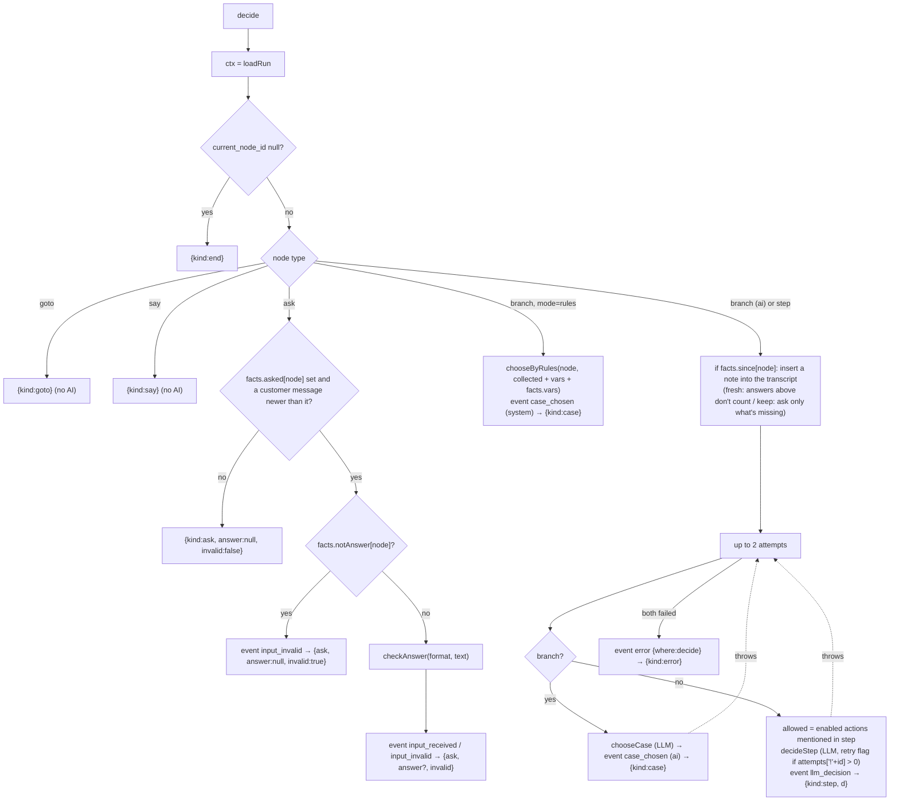

- Trace for each LLM call: `traceFor(conversation_id, "r<runShort>", nodeId, 'case'|'decide', "v<visit>", "a<attempt>")` (§10.3).
- The step-decision JSON contract (`decider.ts:9-20`) is `decision ∈ complete | ask_customer | call_action | escalate`, plus `collected, message, missing, action{key,args}, reason`. An invalid `decision` value throws, which uses up an attempt.

### 7.4 `act(runId, dec)` — run the chosen action (`steps.ts:100-141`)

Only called for `call_action`. The whole body is wrapped in `try/catch`. Any throw → event `error {where:act}` → `{status:'failed'}`.

| # | Check / action | Outcome |
|---|---|---|
| 1 | `key` must be mentioned (`@action`) in **this step's** content | `invalid` "not allowed in this step" |
| 2 | `getAction(key)` must exist and be `enabled` | `invalid` "… is disabled" |
| 3 | `validateArgs` (§9.1) | `invalid` with the error |
| 4 | `facts.outputs[node]` exists and isn't an approval placeholder | `done` with the **existing** output (no re-run) |
| 5 | event `action_called {key,args}` | — |
| 6 | `escalate_to_human` | `escalated` with `args.reason` |
| 7 | `request_approval` | `openTask(kind 'evidence', summary, evidence {attachment_ids: collected.attachment_ids ?? all transcript attachments, facts: outputs})` → `wait_approval` |
| 8 | `action.requires_approval` | `openTask(kind 'action', summary "<name>[: $x.xx][ for <subject>]", action_key, action_args, amount_minor, evidence {reason, facts})` → `wait_approval` |
| 9 | else | `executeAction(..., mode 'auto', visit = visitOf(facts))` → event `action_result` → `done` or `failed` |

`openTask` (`steps.ts:475-488`) is idempotent per `(run, node)` while a task is pending: it returns the existing pending task, which pairs with the partial unique index. Otherwise it inserts with `due_at = now + APPROVAL_TIMEOUT_SEC` and logs `approval_requested`.

### 7.5 `advance(runId, dec, out)` — apply the decision to state (`steps.ts:144-291`)

Local helpers:
- `finish(status, reason)`: saves status, clears `waiting_for`, sets `ended` (and `current_node_id=null` when completed), logs `run_completed` / `run_<status>` → `end`.
- `go(from, jump)`: calls `follow()` (§7.8). `LIMIT` → outbox handover text → `finish('escalated','loop_limit')`. `to=null` → `finish('completed')`. Otherwise sets the cursor and status `running` → `continue`.
- `fail(node, err)`: outbox "Sorry, I hit a problem…", status `failed`, `waiting_for=null`, event `run_failed` → `wait` with a deadline of now + 1 h.

| Decision | Behaviour |
|---|---|
| `end` | `finish('completed')` |
| `error` | `fail` |
| `case` | `facts.cases[node] = {case_id, reason}`, then `go(node, flow.afterCase(node, caseId))` |
| `goto` (tree only) | `forward` = target's document position > goto's. `rerun(r, goto.id, max_visits, fresh, forward ? [] : between(target, goto))`. Over the limit → outbox handover, event `goto_limit`, `finish('escalated','loop_limit')`. Otherwise cursor = target, event `goto_jumped {target, visit, max_visits, direction}`, `continue` |
| `say` | Render the bubble with `shown` vars (declared-but-empty vars render as `''`). Push `{text, verbatim:true, nodeId}`. `moveOn` |
| `ask` with answer | `facts.vars[saveAs] = value`, `varsBy`, `outputs[node] = {saveAs: value}`, clear `asked[node]`. `moveOn` |
| `ask` without answer | Clear `notAnswer[node]`. `attempts[node]++`. **> 3** → handover and `finish('escalated','no valid answer after 3 tries')`. Otherwise push the retry text (if invalid: `node.retry` or the per-format `RETRY`) or the rendered prompt. Set `asked[node]=now`. `waiting_for = customer{expects:[saveAs], remind_at, expires_at}`. Status `waiting_customer`, event `waiting` → `wait` until `remind_at` |
| step `complete` | Merge `d.collected` into `facts.collected` (and `collectedBy`). If the step mentions an action but `outputs[node]` is missing → `attempts['!'+node]++`, event `invalid_action`. **> 2** → `fail`. Otherwise `continue` (re-decide). If not, push `d.message` and `moveOn` |
| step `escalate` | Push message (or the default handover). `finish('escalated', d.reason)` |
| step `ask_customer` | `attempts[node]++`. **> 3** → handover and `finish('escalated','asked 3 times without an answer')`. Otherwise push message, `waiting_for` customer with `expects = d.missing`, status `waiting_customer`, event `waiting` → `wait` |
| `call_action` → `done` | Clear `toolError[node]`. `outputs[node] = output`. On the first output, `keepResponse` ("Save response" → `facts.vars`, event `response_saved`). If it's the first output **and** the LLM gave no message → `continue`, so the step re-runs and the LLM explains the result (`act` won't re-execute, see step 4 above). Otherwise push message and `moveOn` |
| `call_action` → `escalated` | Push message or handover. `finish('escalated', reason)` |
| `call_action` → `failed` | If `toolError[node]` is already set → `fail`. Otherwise store the error, event `tool_retry`, `continue`. That gives **one** retry, with the error shown in the prompt |
| `call_action` → `invalid` | `attempts['!'+node]++`, event `invalid_action`. **> 2** → `fail`. Otherwise `continue` |
| `call_action` → `wait_approval` | Push a fixed "sent to our team for a quick approval" text for `kind='action'` (so the LLM can't claim the write happened), or `d.message` for evidence. `outputs[node] = {approval_task_id}`. `waiting_for = approval{task_id, due_at}`. Status `waiting_approval`, event `waiting` → `wait` until `due_at` |

### 7.6 Signals and the run state machine

`signal(runId, s, key)` (`run-control.ts:25-31`) is the one entry point for interventions:

```
ALLOWED (run-control.ts:15-22)
running           → customer_message, pause, cancel
waiting_customer  → customer_message, pause, cancel
waiting_approval  → customer_message, approval_decision, pause, cancel
paused            → customer_message, resume, cancel
failed            → customer_message, retry_step, cancel
completed / escalated / expired / cancelled → (none)
```

Delivery is `DBOS.send(destination 'run:<id>', message, topic 'signal', idempotencyKey)`. Messages queue durably until the loop calls `recv`. **[library behaviour]** Signals sent while the loop is busy (`running`) are consumed at the loop's next `recv`, and are then applied against whatever state the run is in at that point.

| Signal | Idempotency key | Sender |
|---|---|---|
| `customer_message` | `msg:<messageId>` | `onCustomerMessage` |
| `approval_decision` | `task:<taskId>` | `POST /approvals/:id/decide` |
| `pause` / `resume` / `cancel` / `retry_step` | `<op>:<runId>:<Date.now()>` | `POST /runs/:id/:op` |
| `cancel` (topic switch) | `switch:<messageId>` | `switchedTopic` |

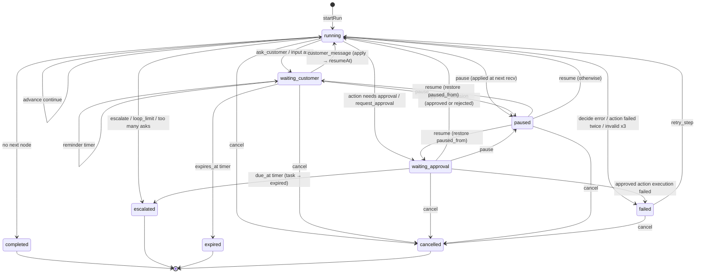

### 7.7 `apply(runId, signal | null)` (`steps.ts:324-421`)

- Already terminal (`completed/escalated/expired/cancelled`) → `end` (the loop exits).
- `end(status, reason, say?)` helper: pushes `say`, **cancels all pending approval tasks of the run**, saves with `ended`, and logs `run_<status>`.

**Timer (`s = null`, i.e. `recv` deadline reached):**

| `waiting_for` | Condition | Effect |
|---|---|---|
| customer | `now ≥ expires_at` | `end('expired', 'customer did not reply', "I haven't heard back…")` |
| customer | `now ≥ remind_at && !reminded` | `reminded=true`, outbox "Just checking in: I still need <expects>…", event `reminder_sent` |
| approval | `now ≥ due_at` | Task → `expired` (only if still pending). `end('escalated','approval timed out', "Our team needs a little more time…")` |
| none (`failed`, `paused`) | — | `wait` another hour. ⚠️ Failed and paused runs never expire on their own |

**Signal:** first, event `signal_applied`. Then:

| Signal | Effect |
|---|---|
| `customer_message` | `waiting_customer` → `resumeAt(current_node_id)` (status `running`, `waiting_for=null` → `run`). `waiting_approval` → outbox "our team is still reviewing…", `wait`. Other statuses (`running`, `paused`, `failed`) → `wait`, and the message stays in the transcript for the next decision |
| `approval_decision` | Ignored unless `waiting_approval` and `waiting_for.task_id` matches. For `kind='action'` and approved: `executeAction(task.action_key, task.action_args, mode 'approved', taskId, visit)` → event `action_result`. On failure → outbox apology, status `failed`, `wait` 1 h. On success → `outputs[node] = result` and `keepResponse`. For rejected, or any evidence task: `outputs[node] = {approved, reviewed_by, reviewer_note}`. Then `follow(node, flow.next(node))` → `LIMIT` → escalate, else `resumeAt(next)` |
| `pause` | `paused_from = {status, waiting_for}`, status `paused`, `waiting_for=null` → `wait` 1 h |
| `resume` | Only if `paused`. If `paused_from.status` was `waiting_customer`/`waiting_approval`, restore it with its `waiting_for` and wait to the original deadline. Otherwise `resumeAt(current_node_id)` |
| `retry_step` | Only if `failed`. Reset `attempts['!'+node]=0` → `resumeAt(current_node_id)`. Note: `toolError[node]` is **not** cleared, so a retried tool step that fails again fails the run immediately |
| `cancel` | `end('cancelled', 'cancelled by <by>')` |

⚠️ After an approval, the run continues at the **next** node. The step that requested approval is not re-run, so whatever the customer hears about the outcome comes from later steps.

### 7.8 Go to step and loops (`rerun`, `follow`, `visitOf`)

- **Tree `goto` node** (handled in `advance`). A forward jump re-runs nothing. A backward jump re-runs `between(index, target, goto)`, which is every node in document order from the target to the goto, including nodes inside branches.
- **Graph edges** (`follow`, `steps.ts:455-473`). For canvas runs, every finished item is appended to `facts.trail`. If an edge leads to an item already on the trail, it's a loop back. `rerun(edge.id, edge.maxVisits, edge.fresh, trail.slice(back))` runs, the trail is truncated, and event `goto_jumped` is logged with direction `back`. Moving to the next item *within* a group never counts as a loop.
- `follow()` also resets `attempts[from]` and `attempts['!'+from]` whenever a node is left.
- **`rerun(r, key, max, fresh, ids)`** (`steps.ts:434-452`):
  - `visit = (visits[key] ?? 1) + 1`. If `max && visit > max` → `false` (limit). So `max_visits` counts total runs of the target including the first.
  - For each re-run id: move `outputs` → `previous`. Delete `outputs`, `cases`, `attempts`, `attempts['!']`, `asked`. Set `since[id] = {at:now, fresh}`. If `fresh` ("Ask again"), also delete the `collected` keys and `vars` that node filled.
- **`visitOf(facts) = 1 + Σ(visits[k] − 1)`** (`steps.ts:97`). It's global across all jumps and feeds the action idempotency key, so a re-run action gets a new `action_run`.
- In `decide`, a `since` marker inserts a `note` line into the transcript at the jump time. `decider.transcript` renders it as `(…)`, which tells the LLM which earlier answers still count.

### 7.9 `flush(runId)` (`steps.ts:294-321`)

1. Read the run. If the outbox is empty → `null`.
2. Walk the outbox in order. Runs of consecutive string notes are merged by `compose()`: one note goes out as-is with no LLM call, several go through one LLM call, and a compose failure falls back to `join('\n\n')`. Verbatim items flush the pending notes first, then go out as their own message.
3. For each part: `insert message (role 'bot', run_id)` and event `message_sent` (actor `ai` for merged notes, `system` for verbatim), with tokens and cost when an LLM merged it.
4. `update workflow_run set outbox='[]'`.

⚠️ This isn't atomic. A crash after some inserts but before the outbox is cleared re-sends those messages on replay. Steps are at-least-once (§7.10).

### 7.10 Durability, recovery and idempotency summary

| Operation | Guarantee | Mechanism |
|---|---|---|
| Loop progress | Resumes at the last completed step after a crash or restart | DBOS checkpoints and `DBOS.launch()` recovery **[library behaviour]** |
| LLM calls inside a completed step | Not repeated | Step output checkpointed |
| LLM calls inside a step that crashed mid-way | **Repeated** (new random sub-thread suffix, so GTWY history doesn't double up, `gtwy.ts:46-54`) | — |
| `run_event`, `llm_usage`, `message` inserts inside a step | **At-least-once** (may duplicate if the step crashes after the insert) | No dedup keys |
| Action execution | One `action_run` per `<runId>:<nodeId>:<visit>`. A committed success is never re-executed. Concurrent executions are serialised by a row lock | `idempotency_key` unique + `select … for update` (§9.2) |
| Action execution, crash *after* the external call but *before* commit | ⚠️ **May re-execute** (row still `running`) | — |
| Signals | Deduplicated by idempotency key | `DBOS.send` idempotency **[library behaviour]** |
| Approval decision | First decider wins | `update … where status='pending'` |
| One active run per conversation | Enforced | Partial unique index + `23505` handling |

---

## 8. Workflow definitions: tree, graph, validation, Flow

### 8.1 Tree utilities (`server/src/workflows/tree.ts`)

| Function | Lines | Purpose | Used by |
|---|---|---|---|
| `indexTree(steps)` | 6-15 | Map id → `{node, list, idx, parentBranch, pos}` (document order) | `treeFlow` |
| `nextAfter(map, id)` | 18-24 | Next sibling, else the node after the enclosing branch (recursively), else `null` | `treeFlow.next/afterCase` |
| `between(map, from, to)` | 27-31 | Ids with `pos` between from and to (what a back-jump re-runs) | `advance` goto |
| `countSteps` | 35-37 | Counts `step` nodes recursively (branches and gotos don't count) | `validateWorkflow` |
| `mentions` | 39-47 | `@actions` and `{{vars}}` in steps and conditions | `validateWorkflow` |
| `renderInline(content, vars)` | 50-55 | Text. `@action` → `` `key` ``. `{{var}}` → value, or the literal `{{var}}` if unknown | prompts, `advance` say/ask, `graph.words` |
| `stepActions(content)` | 57-59 | Action keys mentioned in a step | `decide`, `act`, `advance` |
| `isBranch` | 61-63 | Type guard | **unused** |

### 8.2 Tree validation: `validateWorkflow(steps, enabledActions)` (`validator.ts:8-62`)

Issues are human-readable strings. They don't block saving, but they do block publishing.
- `steps` must be an array.
- Each node needs a unique `id`. Case ids are added to the id set but not checked for duplicates themselves.
- `step`: content must be a list with non-empty text (action and var chips count as text).
- `goto`: needs a `target` that exists (any non-goto node, earlier or later), and `max_visits` must be an integer from 1 to `maxVisits` (100).
- `branch`: depth must be under `maxDepth` (2). The first case must be `if`, only the first may be `if`, `else` must be last, non-else conditions must be non-empty, and every case needs at least one step.
- Step count must be between 1 and `maxSteps` (15).
- Every `@action` must be in the enabled set. Every `{{var}}` must be one of the built-ins.
- Not validated for trees: `rules`/`mode` on branch cases (rules-mode trees run but aren't validated), and `save` fields.

### 8.3 Graph (canvas) — `server/src/workflows/graph.ts`

**`validateGraph(g, enabledActions)`** (`:127-209`):
- There must be at least one group, every group must have items, and item ids must be unique across the graph.
- Step: non-empty. A step with `save` must contain an `@action`, each saved field needs a path and a var, and no var can repeat.
- Bubble: non-empty, and no `@action`.
- Input: needs `saveAs` and a known `format`.
- Condition: the first case must be `if`, `else` must be last, and AI-mode conditions must be non-empty. In rules mode, each case needs at least one rule, each rule a `var`, `ref !== ''`, and a known op.
- `start` must exist. Every edge needs existing groups. `to.itemId` must be in `to.groupId`. `from.itemId` + `port` must be a real condition case. **Each output may have only one arrow**, and `maxVisits` must be 1–100.
- Every group must be reachable from the start (BFS).
- **Loops:** `cycles()` finds strongly connected components with Tarjan (`:106-125`). Each SCC needs **at least one** edge inside it with `maxVisits`. ⚠️ This is checked per SCC, not per cycle (§17 R8).
- Step count (everything except conditions) must be ≤ `maxGraphSteps` (50). Actions must be enabled. Vars must be built-ins or in `graph.variables`. Own variable names must match `^[a-z][a-z0-9_]*$`.

**`treeToGraph(steps)`** (`:15-61`), used by `POST /workflows/:id/canvas`:
- Walks the tree into groups. A condition ends its group. Each non-empty case starts a new group titled from its first five words (or "Otherwise"), and everything after the condition continues in a new "Then" group that every case joins. A case with no steps links straight to "Then". With no `else`, the condition's group end also links to "Then" (fall-through).
- A goto becomes an edge `{to:{groupId, itemId: target}, maxVisits, fresh}`, either from the group end or from the case port when the goto is the case's first step.
- Empty groups other than the start are removed, and edges into them are rewired to where they lead (or dropped if they lead nowhere).
- Finally `layout()` (`:64-82`): BFS depth → `x = depth*400`, stacked `y` using `cardHeight` (`:85-86`). Unreachable groups go in the last column.
- ⚠️ Tree-only features that aren't carried over: branch `mode`, `rules`, `join` (case conditions are copied, rules are not) and step `save`.

### 8.4 The `Flow` abstraction (`server/src/runner/flow.ts`)

The runner never looks at `steps` or `graph` directly. It asks a `Flow` (`flowOf(v)`, `:68`) for `first()`, `node(id)`, `next(id)` and `afterCase(id, caseId)`.

| | Tree (`treeFlow`, `:19-41`) | Graph (`graphFlow`, `:43-66`) |
|---|---|---|
| `first()` | `steps[0].id` | First item of the start group |
| `node(id)` | Tree node as-is | `step`→StepNode, `bubble`→`say`, `input`→`ask`, `condition`→`branch` with empty case steps |
| `next(id)` | `nextAfter` | Next item in the group, else the group's outgoing un-ported edge's target (`to.itemId` or the target group's first item), else `null` |
| `afterCase(id, case)` | First step of the case, else `nextAfter` | The edge from `(itemId, port=case)`, else `next(id)` (fall-through) |
| goto | Explicit `goto` nodes (`kind==='tree'` exposes `tree` index for `between`) | Back-edges detected via `facts.trail` in `follow` |

### 8.5 Input blocks and rules (`server/src/runner/blocks.ts`)

- `checkAnswer(format, raw)` (`:4-22`): `email` (first email-looking token, lowercased), `number` (first number after stripping commas), `phone` (strip everything except digits and `+`, then `^\+?\d{7,15}$`), `text` (any non-empty).
- `RETRY` (`:24-29`): default re-ask texts per format.
- `test(rule, values)` (`:32-46`): string compare, case-insensitive and trimmed. `>`/`<` are numeric and need a non-empty left side. `ref` compares against another variable.
- `chooseByRules(branch, values)` (`:49-57`): the first case whose rules all match (`and`, the default) or any match (`or`) wins. `else` catches the rest. With no `else` → `case_id:null`, which falls through. Values = `{...facts.collected, ...vars, ...facts.vars}`.
- `getPath(obj, path)` (`:60-68`): `a.b`, `a[0].b`, `a.0.b`, `.length`.
- `saveResponse(facts, nodeId, save, output)` (`:71-85`): copies the mapped paths into `facts.vars` and records `varsBy[nodeId]`. Returns `{saved, missing}`.

---

## 9. Action execution and idempotency

### 9.1 `validateArgs(action, raw)` (`server/src/actions/execute.ts:11-25`)
- Copies the args. For each schema property: `undefined/null/''` → removed. `integer` → a numeric string is coerced, and anything that isn't an integer → error. `string` → `String(v)`. Other types pass through unchanged.
- Missing `required` → `missing a, b`. Extra args are **kept** (not stripped).

### 9.2 `executeAction(action, args, ctx)` (`execute.ts:30-61`)

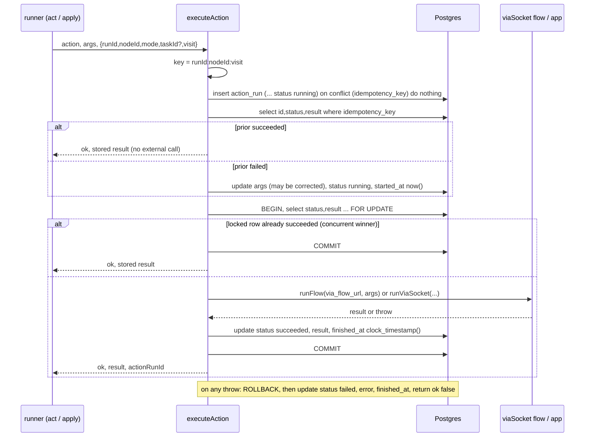

- `subject_ref` and `amount_minor` are filled from `action.subject_field` / `amount_field` when set. They're null for viaSocket flow actions.
- `finished_at` uses `clock_timestamp()` because `now()` inside a transaction is the transaction start (`execute.ts:45`).
- A `source` with no runner (`builtin`, a leftover `mock`) → throws "has no runner" → `failed`. Builtins never get here because `act` handles them first.
- ⚠️ The external HTTP call happens **while a DB transaction and row lock are held**, for up to 60 s (the axios timeout). That ties up one of the 10 pool connections for the duration.
- ⚠️ "Exactly once" holds for completed work and for concurrent callers, but **not** for a crash between the external call returning and the `COMMIT`. The row then stays `running` and a DBOS replay calls the flow again. Whether that duplicates the side effect depends on the flow.

### 9.3 Runners
- `runFlow(url, args)` (`integrations/viasocket.ts:25-31`): re-checks the URL pattern, then `axios.post(url, args, {timeout: 60000, validateStatus: () => true})`. `flowError` (`:35-43`) treats HTTP ≥ 400, `{success:false}`, `status/statusCode ≥ 400` in the body, or a truthy `error` as failures. The message comes from `message` / `error.message` / `error`, or a 300-character JSON excerpt. It returns `r.data ?? {}`.
- `runViaSocket(action, args)` (`execute.ts:64-69`), **legacy** `source='viasocket'`: `renderTemplate(input_template, args)` → `runAppAction(via_service_id, via_action_version_id, inputData)`. That loads `app_connection.script_id_enc`, decrypts it with AES-256-GCM (`iv = bytes 0-11`, `tag = 12-27`, ciphertext after) and calls `ViaSocket.runAction(scriptId, versionId, inputData)`. `{success:false}` with no array `data` → throws.
- `renderTemplate` (`integrations/template.ts:5-14`): a whole-string `{{args.x}}` keeps the arg's type. Embedded placeholders are string-interpolated. It recurses through arrays and objects, including keys.

---

## 10. LLM layer (GTWY)

### 10.1 Authentication and agent (`server/src/llm/gtwy.ts`)

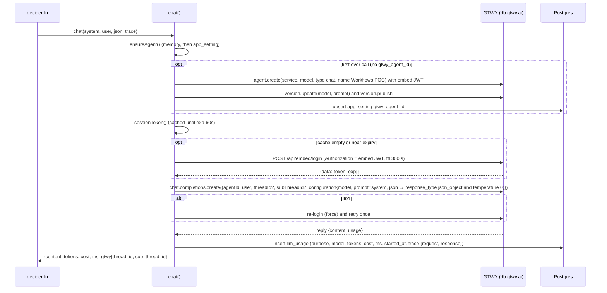

- `sign(ttl)` (`:12-17`): HS256 JWT with `{org_id, folder_id, user_id:'workflows-poc', iat, exp}`, signed with `GTWY_ACCESS_KEY`.
- The GTWY client timeout is 90 s per chat call and 30 s for login and agent setup. There's no retry besides the single 401 refresh. A missing `content` throws "gtwy returned no content".
- ⚠️ `ensureAgent` has no lock. Two concurrent first calls could each create an agent. The last upsert wins.
- `recordUsage` (`:87-97`): `purpose` is the first segment of `trace.sub` that is one of `route|decide|case|compose|topic|reply`, otherwise `call`. `cost_usd` is stored only if GTWY sends a number. An insert failure → `console.warn` only.
- `parseJson` (`:99-102`): strips code fences and parses from the first `{` to the last `}`. A parse failure throws, and the caller handles it (decide retries, route/topic propagate).

### 10.2 Prompts and decisions (`server/src/llm/decider.ts`)

| Function | Lines | JSON | Input | Output and post-processing | Called from |
|---|---|---|---|---|---|
| `decideStep` | 45-67 | yes | Step text (vars rendered), allowed actions with schemas, "already ran" or "must call" hints, last `toolError`, customer identity, known facts (collected, variables, outputs, previous_results), the last 20 transcript lines, optional "Follow the rules exactly." | `StepDecision`. An invalid `decision` throws | `decide` |
| `chooseCase` | 73-82 | yes | Non-else conditions with ids, facts, the last 6 messages | The LLM returns `checks[]`. **Code** picks the first true condition, else `else`, else `null` | `decide` |
| `route` | 94-102 | yes | Workflows `{id,name,when_to_use}`, the last 6 messages | Unknown `workflow_id` → null with confidence 0. No workflows → no LLM call | `onCustomerMessage` |
| `gate` | 105-110 | — | `RouteGuess` | `human` (wants_human ≥ 0.8) / `start` (conf ≥ 0.7) / `clarify` (conf ≥ 0.4 and a question) / `none` | `onCustomerMessage` |
| `compose` | 113-122 | no | Notes | One note → returned as-is (no call) | `flush` |
| `freeReply` | 124-132 | no | Full transcript (last 20) | Free reply text | `onCustomerMessage` (none) |
| `checkTopic` | 144-158 | yes | Current workflow, pending question, reply, other workflows, the last 6 messages | Normalised `kind`. `new_request` with an unknown id → `neither` | `switchedTopic` |

`transcript()` (`:24-30`): the last 20 messages as `Customer:` / `Teammate:` / `Assistant:` lines with `[attached: file (attachment id …)]`. `note` entries render as `(text)`.

Guardrails enforced in code, not trusted to the LLM: the action must be mentioned in the step; the action must be enabled; arguments are schema-validated; `requires_approval` is checked; a step with an action can't `complete` until its output exists; case choice is computed from per-condition truth; the text sent while an approval is pending is fixed; at most 2 decide attempts; and attempt counters escalate or fail the run.

### 10.3 Trace ids (`gtwy.ts:49-54`)

`traceFor(conv, ...parts)` → `{thread: 'conv-<conversationId>', sub: '<parts>-<4 random chars>'}`, capped at 120 characters. Examples:
- Route: `route-<msg8>-xxxx`
- Topic: `r<run8>-topic-<msg8>-xxxx`
- Step: `r<run8>-<nodeId>-decide-v<visit>-a<attempt>-xxxx`
- Compose: `r<run8>-compose-xxxx`

Each call gets a fresh sub-thread, so GTWY's thread history never feeds earlier turns back into the prompt.

---

## 11. viaSocket integration

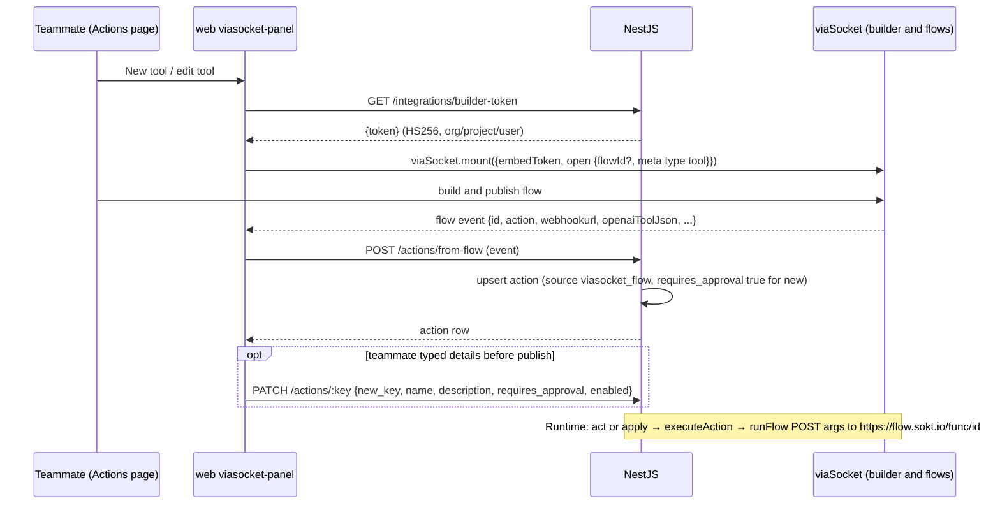

- Pause in viaSocket → `enabled=false`. Delete → remove the action, or disable it if a non-archived workflow uses it.
- The flow URL is the credential. The server never authenticates to the flow in any other way.
- Legacy `source='viasocket'` app actions and `app_connection` are still executable, but nothing in the current code creates them (§18).

---

## 12. Approvals lifecycle

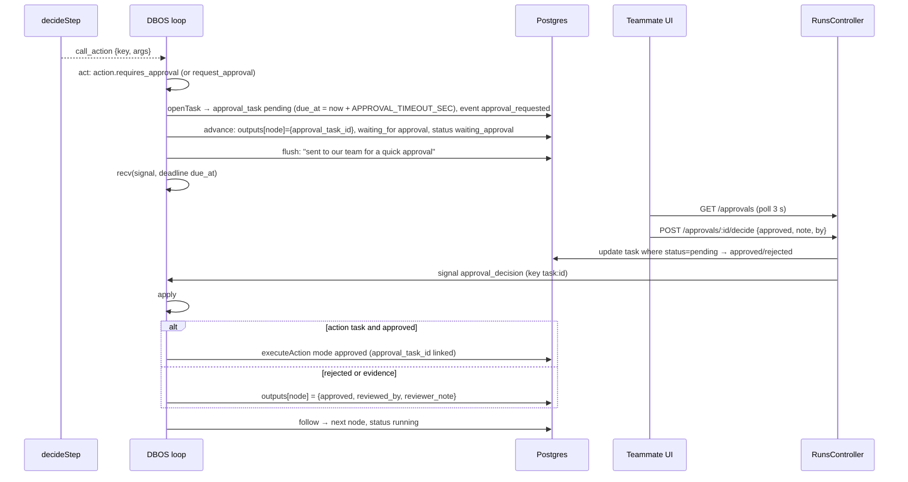

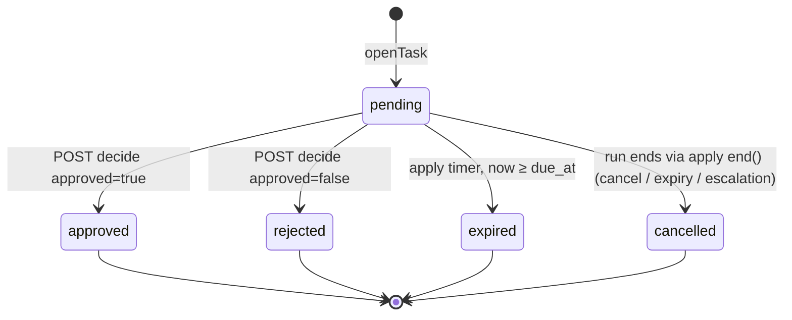

Notes:
- A **rejected** action doesn't stop the workflow. The run continues to the next node with `outputs[node].approved=false`, and later steps or conditions are expected to handle it.
- Only `apply()`'s `end()` cancels pending tasks. Runs that end inside `advance()`'s `finish()` don't touch tasks, but by then no task is pending for that run.
- A customer message during `waiting_approval` → a fixed "still reviewing" reply.

---

## 13. Attachments and file storage

1. `POST /attachments` (base64 JSON, ≤ 5 MB) → row + file at `UPLOADS_DIR/<uuid>` (§5.4).
2. The client includes `attachment_ids` in the next customer message.
3. `loadTranscript` exposes the attachments to the LLM as `[attached: name (attachment id <uuid>)]`, so `decideStep` can put ids into `collected.attachment_ids`.
4. `request_approval` puts `collected.attachment_ids` (or **all** transcript attachments) into `approval_task.evidence.attachment_ids`. `GET /approvals` resolves them for reviewers.
5. `GET /attachments/:id` streams the file with the stored MIME type.

`sha256` is computed but never used for dedup or integrity checks. There is no virus or type scanning. Files are not deleted when a conversation is deleted; the cascade removes only the rows, and no code path deletes conversations anyway.

---

## 14. Web-side backend touchpoints

| Item | Location | Backend relevance |
|---|---|---|
| `/api/:path*` rewrite | `web/next.config.ts` | Active only when `API_ORIGIN` is set. The browser calls `/api/...` and Next forwards to the API (no CORS involved) |
| `api()` client | `web/src/lib/api.ts` | Base `NEXT_PUBLIC_API_URL` or `http://localhost:4001`. On a network error, 502/503/504 or a non-JSON response, it waits for one shared wake-up probe (`GET /variables`, back-off 1→8 s, up to 90 s), then retries **once**. GETs retry on any of these. Writes retry only on network errors or 502/503 (requests that never reached the API). Error bodies: `message` (string, or object with `message` and `issues`) |
| Polling | `playground/page.tsx:40` (1.5 s: conversation + list), `embed/page.tsx:42` (1.5 s widget), `approvals/page.tsx:14` and `nav.tsx:26` (3 s) | The backend pushes nothing: no WebSockets or SSE. All async results are seen by polling |
| `widget.js` | `web/public/widget.js` | Embeds `/embed` (which calls `/widget/*`) via a `<script>` tag |
| viaSocket panel | `web/src/components/viasocket-panel.tsx:71-95` | Fetches the builder token and forwards flow events to `POST /actions/from-flow` |

Every one of the 31 server routes in §5 is called by the web client. `GET /attachments/:id` is the only one not called through `api()`: it's used directly as an ``/`<a href>` (`web/src/app/playground/page.tsx:178`, `web/src/app/embed/page.tsx:93`, `web/src/components/run-panel.tsx:310`).

---

## 15. Mastra spike (out-of-band scripts)

`mastra-spike/` is **not** part of the server runtime. It's a one-day experiment run by hand (`npm run run`, `npm run resume -- "<answer>"`) using `server/.env`.
- `src/run.ts`: reads a published canvas workflow by name from `workflow`/`workflow_version`, compiles it with `src/compile.ts` (one Mastra workflow per canvas group, rules conditions become mutually exclusive `conditional`s, anything unsupported is reported), registers it with `addDynamicWorkflows`, and starts a run that suspends at the input block. It writes `compiled.json` and `.last-run.json`.
- `src/resume.ts`: a fresh process calls `startWorkers()`, restores the run and resumes it with an answer.
- `src/mastra.ts`: `PostgresStore` in schema `mastra_spike`. Tools `send_message` (logs only) and `run_action`, which **reads `action.via_flow_url` and POSTs to the real flow**, applies "Save response" and does **not** write `action_run`. Plus a code-defined `ask_input` suspend workflow.
- DB side effects: creates schema `mastra_spike` (the README says 43 tables). It reads `workflow`, `workflow_version` and `action` and doesn't write the app tables.
- The conclusion recorded in its README: not a drop-in replacement for the current DBOS runner.

---

## 16. Cross-feature dependencies and coupling

### 16.1 Module import graph (verified from imports; no circular imports)

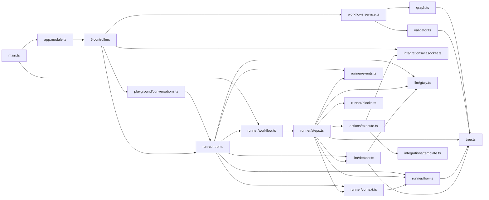

### 16.2 Shared functions and their callers

| Function | Callers | Notes |
|---|---|---|
| `postCustomerMessage` | `POST /conversations/:id/messages`, `POST /widget/conversations/:id/messages` | One pipeline for both channels |
| `signal` | `onCustomerMessage`, `switchedTopic`, `POST /runs/:id/:op`, `POST /approvals/:id/decide` | Single state-machine gate (`ALLOWED`) |
| `startRun` | `onCustomerMessage`, `switchedTopic` | Relies on the unique active-run index |
| `loadRun` | `decide`, `act`, `advance`, `apply`, `markNotAnswer` | Reads fresh state every step |
| `loadTranscript` | `loadRun`, `onCustomerMessage`, `switchedTopic` | Excludes `system` messages |
| `saveRun` | `advance`, `apply` | Full-row overwrite |
| `addEvent` | runner steps, `signal`, `startRun`, `switchedTopic`, `openTask`, `keepResponse`, `follow` | Append-only |
| `executeAction` | `act` (auto), `apply` (approved) | Idempotency key and row lock |
| `getAction` | `decide`, `act`, `apply` | Reads `enabled`/`requires_approval` live |
| `chat` | every decider function | Writes `llm_usage` |
| `renderInline` | prompts, `advance` (say/ask), `graph.words` | |
| `flowOf` | `loadRun`, `startRun` | Tree vs graph switch |
| `rerun` / `follow` | `advance`, `apply` | Loop limits and fact clearing |
| `getWorkflow` | every workflow-service write path | Includes live validation |

### 16.3 Hidden coupling and invariants

1. **Status lists are duplicated in four places:** `ACTIVE` (`types.ts:67`), the SQL partial index `workflow_run_one_active` (0004), `TERMINAL` (`steps.ts:33`) and `ALLOWED` (`run-control.ts:15-22`). Adding a status needs all four updated, plus the check constraint.
2. **Action keys are plain text** embedded in workflow content (`Inline.key`), `action_keys` arrays, `action_run` and `approval_task`. That's why renaming is blocked once a workflow or version uses the key, and deleting is blocked once a non-archived workflow does.
3. **Node ids are durable references.** `facts.*`, `run_event.node_id`, `approval_task.node_id`, `action_run.node_id` and idempotency keys all use them. `treeToGraph` keeps ids so in-flight data stays consistent.
4. **The DBOS workflow id is `run:<workflow_run.id>`.** `signal`, `startRun` and `dbos-steps` all build it independently.
5. **The idempotency key format `<runId>:<nodeId>:<visit>`** depends on `visitOf(facts)` being identical between `act` and `apply`. It is, unless a jump happens between them, and a run in `waiting_approval` can't jump.
6. **`llm_usage.purpose`** is parsed out of the trace sub-thread string. Renaming the trace parts in `traceFor` calls changes the cost breakdown.
7. **Routing uses draft metadata** (`workflow.name/when_to_use`) and **published content** (`published_version_id`).
8. **`requires_approval` and `enabled`** are read at call time, so changes affect running runs immediately.
9. **Config limits** (`maxVisits`, `maxSteps`, `maxDepth`, `maxGraphSteps`) are only enforced at validation and publish time. The runner trusts published content.
10. **Boot order:** env check → DBOS registration import → `DBOS.launch()` → HTTP. Migrations must already be applied.

---

## 17. Risks, race conditions and edge cases

All items below follow from the code paths cited. None has been reproduced at runtime.

| ID | Risk | Path | Consequence |
|---|---|---|---|
| R1 | **Approval decided while the run is paused** | `POST /approvals/:id/decide` updates the task first, then `signal()` rejects `approval_decision` for `paused` (`runs.controller.ts:36-41`, `run-control.ts:19`) | The task stays approved or rejected, but the run never receives the decision. After resume it waits until `due_at`, then escalates with "approval timed out" (the task isn't pending, so it isn't marked expired) |
| R2 | **Crash between the external action call and commit** | `execute.ts:46-55` | The `action_run` stays `running`, and DBOS replay calls the flow again. The README's "can't refund twice" holds only for committed successes |
| R3 | **Topic switch timeout** | `run-control.ts:88-97` | If the cancelled run is still active after 10 s, `startRun` silently no-ops, `'switched'` is returned, and the customer message reaches no run |
| R4 | **Orphaned active run** | `startRun` insert succeeds but `DBOS.startWorkflow` throws (`run-control.ts:121-128`), or a DBOS step throws outside the `try` in `decide`/`act` (`advance`, `apply`, `flush` DB errors) | The `workflow_run` row stays ACTIVE with no live loop. Signals queue forever, and the conversation can't be routed again until the row is fixed by hand |
| R5 | **Lost `notAnswer` flag** | `markNotAnswer` writes `facts` outside DBOS. `apply`/`advance` overwrite all of `facts` from an in-memory copy via `saveRun` | If a timer-driven `apply` (reminder) is running at the same moment, the flag can be overwritten. The window is narrow |
| R6 | **At-least-once side effects in steps** | `run_event`, `message`, `llm_usage` inserts inside DBOS steps | Duplicate timeline entries, bot messages or usage rows after a crash mid-step |
| R7 | **Failed and paused runs never expire** | `apply` timer with `waiting_for = null` → `wait` +1 h, repeated forever | The conversation stays blocked (`failed` is ACTIVE) until a teammate retries or cancels. Customer messages are absorbed (`apply` → `waitAgain`) |
| R8 | **Loop limit checked per SCC, not per cycle** | `validateGraph` (`graph.ts:197-200`) | In an SCC with two cycles where only one has a limited edge, the other cycle can repeat without a limit at runtime (`rerun` with `max` undefined) |
| R9 | **Unhandled stream error** | `GET /attachments/:id` (`playground.controller.ts:99-100`) | A missing file can crash the process. **[library behaviour]** |
| R10 | **Concurrent messages** | `onCustomerMessage` is fire-and-forget per message | Two quick messages with no active run: both route, one `startRun` loses on `23505` (warn), and both may add Routing/system messages. With an active run, a queued second `customer_message` signal is applied later and may trigger an extra decide or re-ask |
| R11 | **Publish race** | `publishWorkflow` version numbering | Concurrent publishes → unique violation → 500 |
| R12 | **Name collision on create** | `createWorkflow` suffix logic | 500 on unique-index violation |
| R13 | **Long DB transactions** | `executeAction` holds a row lock and a pooled connection during the external call (≤ 60 s) | With pool `max: 10`, several slow tools can starve other queries |
| R14 | **Permanent escalation** | `onCustomerMessage` stays quiet whenever the *latest* run is `escalated` | There is no API to hand a conversation back to the bot (the old `escalations` module exists only in stale `dist/`) |
| R15 | **`retry_step` keeps `toolError`** | `apply` `retry_step` resets only the `!` counter | A retried tool step that fails again fails the run immediately, with no second LLM correction attempt |

### Security considerations (code-supported)

- **No authentication or authorization on any endpoint.** Anyone who can reach the API can read every conversation, attachment, AI trace (full prompts with customer data), run and approval; decide approvals (with a self-chosen `by`); control runs; create, modify or delete actions; and mint a viaSocket builder token. CORS doesn't protect against non-browser clients.
- `GET /actions` exposes `via_flow_url`, the credential that runs a tool.
- `POST /actions/from-flow` accepts unsigned events. Anyone can register any `flow.sokt.io` URL as an action. New actions do default to `requires_approval = true`.
- Attachments are served with a client-chosen `Content-Type` from the API origin, which is a stored-XSS vector.
- Widget isolation relies on unguessable UUIDs and the `channel='widget'` filter. The non-widget playground endpoints expose widget conversations too.
- LLM prompt injection from customer text is contained by code guards (§10.2), but arguments are whatever the LLM extracted from the conversation. The flow receives them unchanged after schema validation.
- SQL is fully parameterised. No dynamic SQL was found apart from migration DDL.

---

## 18. Dead code, legacy paths and stale artefacts

| Item | Evidence | Status |
|---|---|---|
| `templateArgs()` | `integrations/template.ts:17-21`, no importers | Dead |
| `isBranch()` | `workflows/tree.ts:61-63`, no importers | Dead |
| `runViaSocket` / `runAppAction` / `decrypt` / `app_connection` | Reachable only for `action.source='viasocket'`. Nothing creates such rows or `app_connection` rows now | Legacy, reachable only with old data |
| `action_run.mode = 'test'`, `workflow.template`, `action.builtin`, `action.kind`, `action.input_template`, `via_service_id/app_name/action_version_id/action_name` | Columns never written by current code (apart from defaults and migrations) | Legacy columns |
| `server/dist/escalations/*`, `dist/actions/policy.js`, `dist/llm/prices.js`, `dist/integrations/sheets-demo.js` | No matching `src` file. `dist/app.module.js` doesn't register them | Stale build output (nest build doesn't delete orphans). Harmless but misleading |
| README sections | Mentions first-boot templates ("Order refund", "Damaged item return"), `npm run smoke`, a mock shop and the demo scenarios. Commit `ea4f5f6` removed templates and smoke, migration 0009 removed the mock shop, and `package.json` has no `smoke` script | Documentation drift |
| `server/uploads/*` | 18 uploaded files tracked in the working tree | Test data, not code |

---

## 19. Completeness checklist

Status: ✅ documented · 🟡 partially documented · 🔍 requires verification

### 19.1 API endpoints (31)

| # | Method and route | Handler | Status |
|---|---|---|---|
| 1 | GET `/workflows` | `WorkflowsController.list` | ✅ |
| 2 | GET `/variables` | `WorkflowsController.variables` | ✅ |
| 3 | POST `/workflows` | `.create` → `createWorkflow` | ✅ |
| 4 | GET `/workflows/:id` | `.get` → `getWorkflow` | ✅ |
| 5 | PUT `/workflows/:id` | `.save` → `saveWorkflow` | ✅ |
| 6 | POST `/workflows/:id/publish` | `.publish` → `publishWorkflow` | ✅ |
| 7 | POST `/workflows/:id/canvas` | `.canvas` → `toCanvas` | ✅ |
| 8 | PATCH `/workflows/:id` | `.patch` → `patchWorkflow` | ✅ |
| 9 | DELETE `/workflows/:id` | `.archive` → `archiveWorkflow` | ✅ |
| 10 | GET `/actions` | `ActionsController.list` | ✅ |
| 11 | GET `/actions/:key/sample` | `.sample` | ✅ |
| 12 | GET `/actions/:key` | `.get` | ✅ |
| 13 | PATCH `/actions/:key` | `.patch` | ✅ |
| 14 | DELETE `/actions/:key` | `.remove` | ✅ |
| 15 | POST `/actions/from-flow` | `.fromFlow` | ✅ |
| 16 | GET `/integrations/builder-token` | `IntegrationsController.builder` | ✅ |
| 17 | GET `/conversations` | `PlaygroundController.list` | ✅ |
| 18 | POST `/conversations` | `.create` | ✅ |
| 19 | GET `/ai-calls/:id` | `.aiCall` | ✅ |
| 20 | GET `/conversations/:id` | `.get` | ✅ |
| 21 | POST `/conversations/:id/messages` | `.send` → `postCustomerMessage` | ✅ |
| 22 | POST `/conversations/:id/team-messages` | `.teamSend` | ✅ |
| 23 | POST `/attachments` | `.upload` | ✅ |
| 24 | GET `/attachments/:id` | `.file` | ✅ |
| 25 | POST `/widget/conversations` | `WidgetController.start` | ✅ |
| 26 | GET `/widget/conversations/:id` | `.get` | ✅ |
| 27 | POST `/widget/conversations/:id/messages` | `.send` | ✅ |
| 28 | POST `/runs/:id/:op` | `RunsController.control` | ✅ |
| 29 | GET `/runs/:id/dbos-steps` | `.dbosSteps` | 🟡 output shape depends on the DBOS SDK |
| 30 | GET `/approvals` | `.approvals` | ✅ |
| 31 | POST `/approvals/:id/decide` | `.decide` | ✅ |

### 19.2 Business functions and service methods

| Area | Functions | Status |
|---|---|---|
| Workflow service | `listWorkflows, getWorkflow, createWorkflow, saveWorkflow, publishWorkflow, toCanvas, patchWorkflow, archiveWorkflow, check, enabledActionKeys, rid` | ✅ |
| Validation and conversion | `validateWorkflow, validateGraph, cycles, treeToGraph, layout, cardHeight, graphMentions, graphStepCount` | ✅ |
| Tree utils | `indexTree, nextAfter, between, countSteps, mentions, renderInline, stepActions, isBranch` | ✅ |
| Run control | `signal, onCustomerMessage, switchedTopic, markNotAnswer, startRun` | ✅ |
| Runner steps | `decide, act, advance, flush, apply, rerun, follow, keepResponse, openTask, visitOf, fmt` | ✅ |
| Runner support | `loadRun, loadTranscript, saveRun, addEvent, treeFlow, graphFlow, flowOf, checkAnswer, chooseByRules, test, getPath, saveResponse` | ✅ |
| Actions | `getAction, validateArgs, executeAction, runViaSocket, toSchema, freeKey` | ✅ |
| Integrations | `builderToken, runFlow, flowError, runAppAction, decrypt, sdk, renderTemplate, templateArgs` | ✅ (`runAppAction` 🟡: viaSocket SDK internals not inspected) |
| LLM | `chat, sign, sessionToken, ensureAgent, recordUsage, parseJson, traceFor, shortId, decideStep, chooseCase, route, gate, compose, freeReply, checkTopic, transcript` | ✅ (GTWY SDK internals 🔍) |

### 19.3 Database models and significant queries

| Item | Status |
|---|---|
| 13 app tables + `schema_migrations` | ✅ |
| `dbos` schema tables | 🔍 managed by DBOS, not in repo |
| Partial unique indexes (active run, pending approval, active name) | ✅ |
| Optimistic lock (`row_version`), publish tx, action row lock | ✅ |
| jsonb merge in `markNotAnswer`, jsonb array join in approvals | ✅ |

### 19.4 Background jobs, scheduled tasks, events and consumers

| Item | Status |
|---|---|
| DBOS workflow `runWorkflow` (one per run) | ✅ |
| DBOS `recv('signal')` consumer, `send` producers (4 senders) | ✅ |
| Timers: reminder, expiry, approval timeout, 1 h idle (via `recv` deadlines; there are no cron jobs) | ✅ |
| Fire-and-forget `onCustomerMessage` | ✅ |
| DBOS recovery on boot | 🟡 relies on DBOS semantics |
| Webhook-like ingestion `POST /actions/from-flow` (browser-relayed) | ✅ |
| Scheduled jobs / cron / queues besides DBOS | None exist ✅ |
| WebSockets / SSE / streaming | None exist (polling only) ✅ |

### 19.5 External integrations

| Integration | Status |
|---|---|
| GTWY embed login, agent create/update/publish, chat completions | ✅ (SDK request shapes beyond our call site 🔍) |
| viaSocket builder token, flow run URL | ✅ |
| viaSocket Apps SDK `runAction` (legacy) | 🟡 |
| Render deployment | ✅ (dashboard-only settings 🔍) |

### 19.6 Error handling and retry mechanisms

| Mechanism | Status |
|---|---|
| decide: 2 LLM attempts → `error` → `failed` | ✅ |
| Invalid action ×3 → failed. Ask ×3 → escalated. Input ×3 invalid → escalated | ✅ |
| Tool failure: 1 retry with error in prompt | ✅ |
| GTWY 401 → one re-login | ✅ |
| compose failure → plain join | ✅ |
| Topic check failure → pass | ✅ |
| onCustomerMessage failure → system message | ✅ |
| `llm_usage` insert failure → warn | ✅ |
| Client wake-up retry (web) | ✅ |
| DBOS step retry policy | 🔍 not configured. Library default |

---

## 20. Cross-check results and remaining coverage gaps

**Cross-check performed against the repository:**
- Every `@Get/@Post/@Put/@Patch/@Delete` decorator in `server/src/**/*.controller.ts` (6 controllers, 31 routes) appears in §5 and §19.1. The routes match the paths the web client calls (`web/src/**`, `web/public/widget.js`) one for one.
- Every file in `server/src` (29 files) and every migration (10 files) is referenced in at least one section.
- `dist/app.module.js` registers the same 6 controllers as `src/app.module.ts`, which confirms the extra `dist/` files are orphans.
- No Nest providers, guards, interceptors, pipes, middleware, cron decorators, queues, WebSocket gateways or SSE handlers exist in `src`.
- Import graph checked for cycles: none.

**Remaining gaps (could not be verified from this repository):**
1. **DBOS internals**: the exact `dbos` schema tables, the `runStep` default retry policy in `@dbos-inc/dbos-sdk` 5.x, `send` idempotency-key semantics, and recovery behaviour across `applicationVersion` changes. These are described from general DBOS behaviour and marked **[library behaviour]**.
2. **GTWY SDK (`gtwy-sdk` 0.5)**: the HTTP routes and payloads behind `agent.create`, `version.update/publish` and `chat.completions.create`, and the exact `usage` field names beyond `inputTokens`, `outputTokens`, `totalTokens` and `cost` as read in `gtwy.ts`. The SDK ships no types (`gtwy-sdk.d.ts`).
3. **viaSocket**: the full flow-event schema (only the fields read in `FlowEvent` are documented), whether builder tokens without `exp` are accepted indefinitely, and `viasocket-apps` `runAction` internals.
4. **Migration 0008**: missing from the folder. It's unclear whether it was deleted on purpose or ever applied to existing databases (check `schema_migrations` in each environment).
5. **Runtime confirmation**: §17 lists risks found by reading the code. None were reproduced against a running instance.
6. **Render dashboard settings** (persistent disk, instance count) that affect upload durability and DBOS recovery are not in `render.yaml`.
7. **Frontend internals** beyond the backend touchpoints in §14 (component behaviour, `web/src/lib/graph.ts`/`tree.ts` client-side mirrors of the server logic) are out of scope and not documented.
8. **`mastra-spike/src/compile.ts`** is summarised from its README and exported symbols, not traced line by line, because it's not part of the server runtime.
