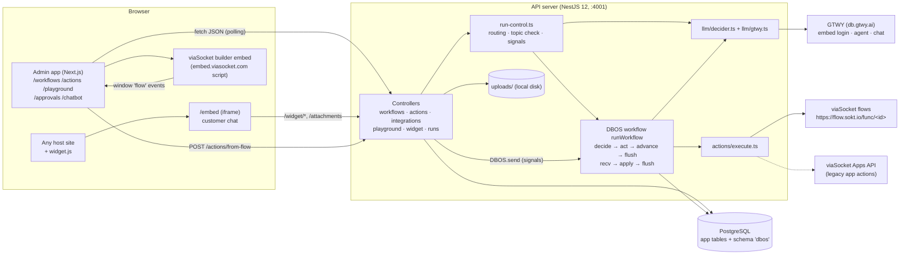
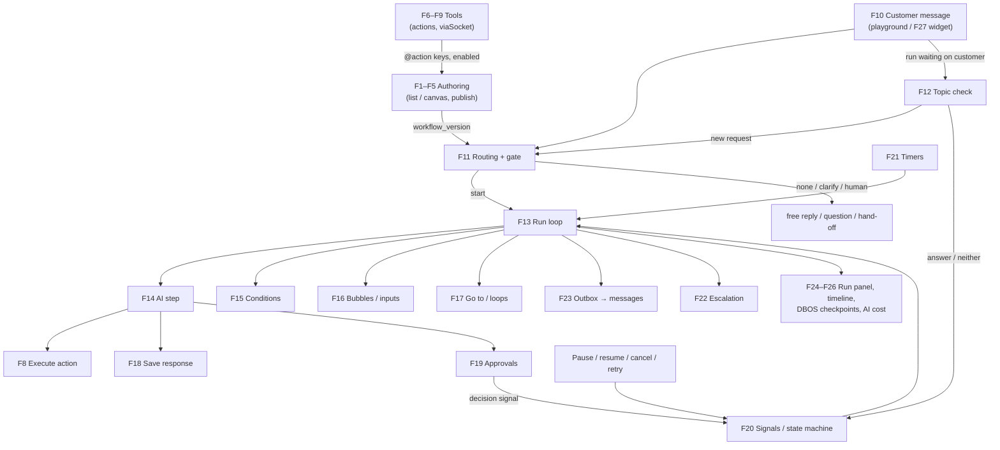
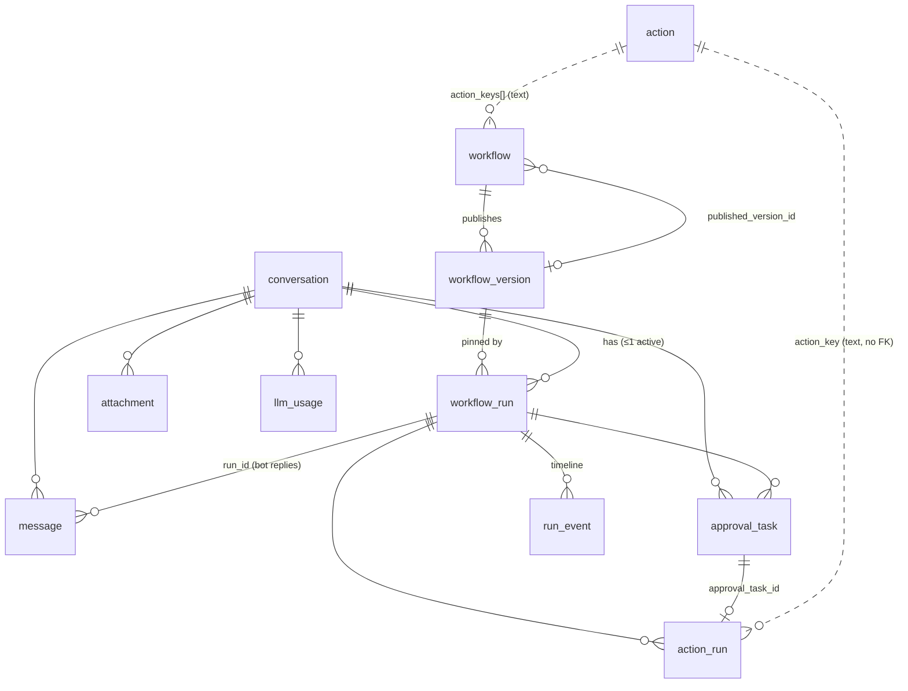
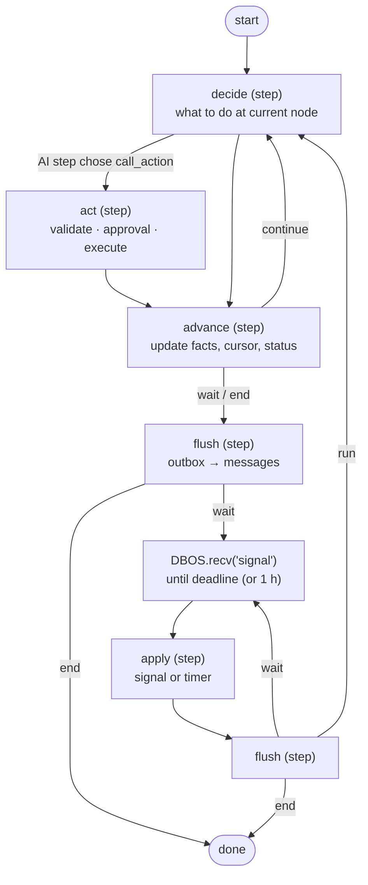
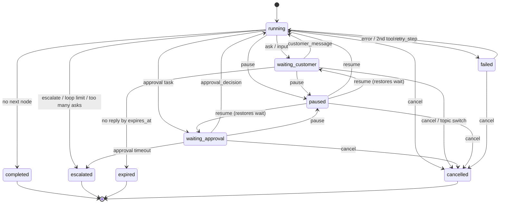
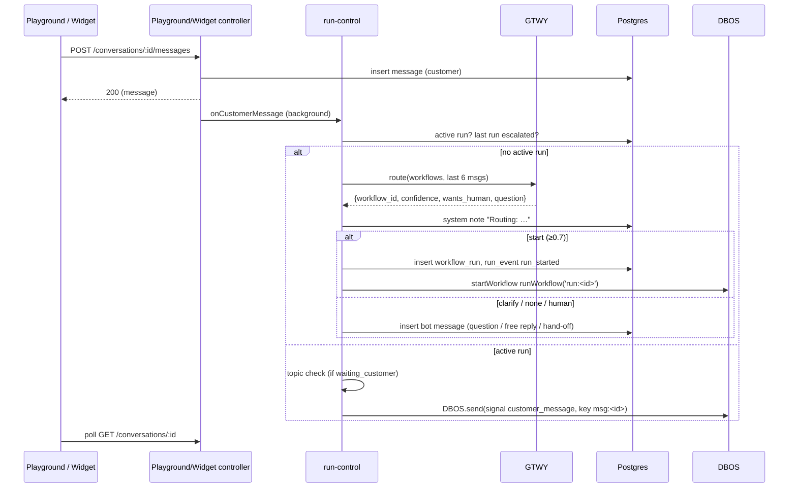
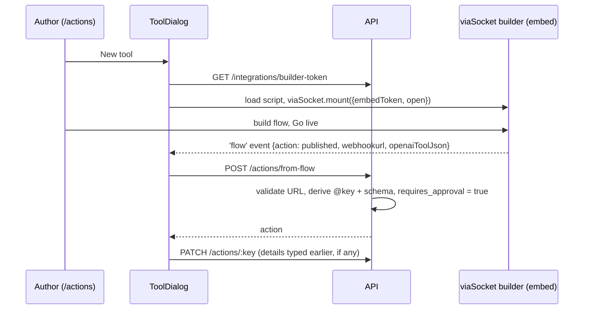
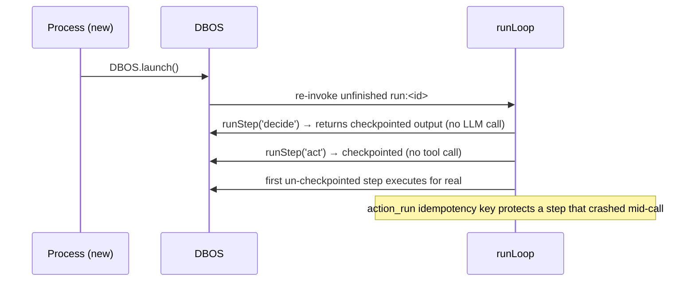

# Workflows POC — High-Level Functional Documentation

> Scope: everything tracked in this repository (`server/`, `web/`, `render.yaml`, migrations), plus a short note on the untracked `mastra-spike/` folder.
> Source of truth: the code at commit `245ec15` (merge of PR #9, "exact GTWY AI cost"). Every claim below points to a file; anything that could not be confirmed from code is marked **⚠ Unverified**.
> Low-level details (SQL, prompt wording, exact JSON shapes) are left to the code and to `docs/backend-deep-dive.html`.

---

## Table of contents

1. [Project overview](#1-project-overview)
2. [System architecture](#2-system-architecture)
3. [Repository structure](#3-repository-structure)
4. [Data model](#4-data-model)
5. [Configuration and environment](#5-configuration-and-environment)
6. [Feature inventory](#6-feature-inventory)
7. [Features](#7-features)
   - [Authoring](#authoring)
     - [F1 Workflow management](#f1-workflow-management)
     - [F2 List (tree) editor](#f2-list-tree-editor)
     - [F3 Canvas (graph) editor](#f3-canvas-graph-editor)
     - [F4 Convert list → canvas](#f4-convert-list--canvas)
     - [F5 Validation, drafts and publishing](#f5-validation-drafts-and-publishing)
   - [Tools](#tools)
     - [F6 Actions catalog](#f6-actions-catalog)
     - [F7 viaSocket tool builder](#f7-viasocket-tool-builder)
     - [F8 Action execution (exactly once)](#f8-action-execution-exactly-once)
     - [F9 Built-in actions](#f9-built-in-actions-request_approval-escalate_to_human)
   - [Conversations](#conversations)
     - [F10 Conversations, messages and attachments](#f10-conversations-messages-and-attachments)
     - [F11 Routing and the confidence gate](#f11-routing-and-the-confidence-gate)
     - [F12 Topic-change detection](#f12-topic-change-detection)
   - [Run engine](#run-engine)
     - [F13 Durable run loop (DBOS)](#f13-durable-run-loop-dbos)
     - [F14 AI steps](#f14-ai-steps)
     - [F15 Conditions (AI-judged and rule-based)](#f15-conditions-ai-judged-and-rule-based)
     - [F16 Text bubbles and input blocks](#f16-text-bubbles-and-input-blocks)
     - [F17 Go to step and canvas loops](#f17-go-to-step-and-canvas-loops)
     - [F18 Workflow variables and "Save response"](#f18-workflow-variables-and-save-response)
     - [F19 Approvals](#f19-approvals)
     - [F20 Run controls and the signal state machine](#f20-run-controls-and-the-signal-state-machine)
     - [F21 Timers: reminders, expiry, approval timeout](#f21-timers-reminders-expiry-approval-timeout)
     - [F22 Escalation and hand-off](#f22-escalation-and-hand-off)
     - [F23 Reply composition (outbox → messages)](#f23-reply-composition-outbox--messages)
   - [Observability](#observability)
     - [F24 Playground and run panel](#f24-playground-and-run-panel)
     - [F25 Run timeline and DBOS checkpoints](#f25-run-timeline-and-dbos-checkpoints)
     - [F26 AI usage, cost and call traces](#f26-ai-usage-cost-and-call-traces)
   - [Channels](#channels)
     - [F27 Embeddable chat widget](#f27-embeddable-chat-widget)
   - [Platform](#platform)
     - [F28 GTWY LLM gateway client](#f28-gtwy-llm-gateway-client)
     - [F29 Database setup and migrations](#f29-database-setup-and-migrations)
     - [F30 Deployment (Render) and cold-start handling](#f30-deployment-render-and-cold-start-handling)
     - [F31 Admin shell and navigation](#f31-admin-shell-and-navigation)
   - [Legacy, experimental and removed](#legacy-experimental-and-removed)
     - [F32 Legacy viaSocket app actions](#f32-legacy-viasocket-app-actions)
     - [F33 Mastra spike (untracked)](#f33-mastra-spike-untracked)
     - [F34 Removed features still described in the README](#f34-removed-features-still-described-in-the-readme)
8. [Critical flows (sequence diagrams)](#8-critical-flows-sequence-diagrams)
9. [API reference (summary)](#9-api-reference-summary)
10. [Architectural risks and observations](#10-architectural-risks-and-observations)
11. [Verification against the repository](#11-verification-against-the-repository)

---

## 1. Project overview

**What it is.** A proof of concept for Ticket0 **workflows**: Chatbase-style support procedures that a business writes in plain English, and an AI agent follows step by step while chatting with a customer.

**Primary use cases**

| Who | What they do | Where |
| --- | --- | --- |
| Workflow author | Writes a workflow as a list of steps or on a canvas; mentions tools as `@action` and values as `{{variable}}`; publishes versions | `/workflows`, `/workflows/[id]` |
| Tool builder | Builds a tool (a viaSocket flow) and exposes it to workflows as an `@action`; marks it "Needs approval" | `/actions` |
| Customer | Chats with the AI (playground persona or embedded widget) | `/playground`, `/embed` via `widget.js` |
| Teammate | Approves/rejects actions and evidence, writes in the chat, pauses/resumes/cancels/retries runs, inspects what the AI did and what it cost | `/playground`, `/approvals` |
| Host product | Pastes one `<script>` tag to embed the chat | `web/public/widget.js`, `/chatbot` |

**Core idea** (from `README.md` and `server/src/runner/*`): a customer message is **routed** to a published workflow by an LLM; a **durable DBOS workflow** walks that version one node at a time; the LLM **decides** each AI node (JSON answer), while **our code** runs tools, enforces approvals, counts loops and sends replies. Every step is checkpointed, so a server restart resumes a conversation without repeating model calls or tool calls.

**POC shortcuts** (explicit in `README.md` and `0001_init.sql`): single tenant (no `org_id`), conversations stand in for tickets, no authentication, replies are sent automatically, files are on local disk, the timeline lives in Postgres.

---

## 2. System architecture

### 2.1 Components



| Component | Responsibility | Main files |
| --- | --- | --- |
| Admin web app | Authoring, playground, approvals, tool management, widget setup. All client components; data via `api()` with polling (1.5–3 s) | `web/src/app/**`, `web/src/components/**`, `web/src/lib/api.ts` |
| Widget | Floating button + iframe loader; customer-only chat UI | `web/public/widget.js`, `web/src/app/embed/page.tsx` |
| API server | REST controllers, routing, durable runner, tool execution | `server/src/**` |
| DBOS | Durable execution: checkpoints each step's result in Postgres schema `dbos`; recovers unfinished runs at launch; delivers signals with `send`/`recv` | `server/src/main.ts`, `server/src/runner/workflow.ts` |
| PostgreSQL | All application state (workflows, versions, runs, messages, approvals, action runs, timeline, AI usage) and DBOS system tables | `server/migrations/*.sql`, `server/src/db.ts` |
| GTWY | LLM gateway: every model call (routing, steps, conditions, topic checks, reply merging, free replies) | `server/src/llm/gtwy.ts` |
| viaSocket | Tool builder (browser embed) and tool runtime (HTTP POST to a flow URL) | `server/src/integrations/viasocket.ts`, `web/src/components/viasocket-panel.tsx` |

### 2.2 Communication

- **Browser → API**: plain JSON over HTTP. No websockets; every screen polls (`playground/page.tsx` every 1.5 s, `approvals/page.tsx` and `nav.tsx` every 3 s, `embed/page.tsx` every 1.5 s).
- In deployment the browser calls `/api/*` on the web origin and Next.js rewrites to `API_ORIGIN` (`web/next.config.ts`); locally it calls `http://localhost:4001` directly with CORS (`server/src/main.ts`).
- **API → run**: controllers never mutate a running run directly. They go through `signal()` (`runner/run-control.ts`), which checks the state machine and calls `DBOS.send('run:<id>', signal, 'signal', idempotencyKey)`. The run consumes it with `DBOS.recv('signal')`.
- **Run → customer**: the run writes `message` rows (role `bot`); screens pick them up on their next poll.
- **viaSocket builder → API**: the builder emits window events in the browser; the admin app forwards them to `POST /actions/from-flow`.

### 2.3 Feature interaction



### 2.4 Shared utilities

| Utility | Purpose | File |
| --- | --- | --- |
| `q`, `one`, `tx` | Thin `pg` helpers: query, single row, transaction | `server/src/db.ts` |
| `config` | All env reads; refuses to boot without `DATABASE_URL` and GTWY keys; holds limits (15 list steps, 50 canvas steps, depth 2, 100 visits) | `server/src/config.ts` |
| `addEvent` | Append a row to `run_event` (the timeline / audit log) | `server/src/runner/events.ts` |
| `loadRun`, `loadTranscript`, `saveRun` | Read a run fresh from the DB inside every DBOS step; write its state back | `server/src/runner/context.ts` |
| `flowOf` / `treeFlow` / `graphFlow` | One navigation interface (`first`, `node`, `next`, `afterCase`) over both workflow shapes | `server/src/runner/flow.ts` |
| `renderInline`, `stepActions`, `indexTree`, `nextAfter`, `between` | Tree helpers and prompt rendering of `@action` / `{{var}}` chips | `server/src/workflows/tree.ts` |
| `api()`, `serverWaking`, `usd`, `money` | Fetch wrapper with cold-start retry, cost/money formatting | `web/src/lib/api.ts` |
| `lib/tree.ts`, `lib/graph.ts` | Client copies of the workflow types plus immutable edit helpers (mirrors server types by hand) | `web/src/lib/*` |
| UI kit | `Button`, `Toggle`, `StatusChip`, `Card`, `AttentionDot`, `JsonView`, `InlineText` | `web/src/components/ui.tsx`, `json-view.tsx`, `inline-text.tsx` |

There is **no middleware** (no auth guards, interceptors or global exception filters) in the NestJS app (`server/src/app.module.ts` registers controllers only).

---

## 3. Repository structure

```
workflows-poc/
├── README.md                 Overview, run instructions (partly out of date — see F34)
├── render.yaml               Render Blueprint: Postgres + API + web (F30)
├── docs/                     Design notes as HTML (backend deep dive, canvas approach/comparison, plans)
├── mastra-spike/             Untracked one-day experiment (F33)
├── server/                   NestJS 12 + DBOS 5 API (port 4001)
│   ├── migrations/           Ordered SQL migrations 0001–0011 (no 0008) (F29)
│   ├── scripts/setup-db.js   Creates the DB if missing, applies migrations once each
│   └── src/
│       ├── main.ts           Boot: DBOS.setConfig + launch (recovers runs), Nest app, CORS, 8 MB JSON body
│       ├── app.module.ts     Registers the six controllers
│       ├── config.ts, db.ts, types.ts, gtwy-sdk.d.ts
│       ├── workflows/        CRUD, publish, validation, tree & graph helpers, list→canvas conversion
│       ├── actions/          Action catalog API, viaSocket flow sync, exactly-once execution
│       ├── integrations/     viaSocket builder token, flow runner, legacy app actions, input templates
│       ├── llm/              GTWY client (auth, agent, chat, usage) and decision prompts
│       ├── playground/       Conversations, messages, attachments, AI-call detail, widget API
│       └── runner/           DBOS loop, steps, flow abstraction, blocks, run control, runs/approvals API
└── web/                      Next.js 16 + React 19 + Tailwind 4 (port 4000)
    ├── next.config.ts        /api rewrite to API_ORIGIN (deploy)
    ├── public/widget.js      Embeddable loader (F27)
    └── src/
        ├── app/              Pages: workflows, workflows/[id], actions, playground, approvals, chatbot, embed, embed-demo
        ├── components/       Editors (list, canvas), run panel, timeline, DBOS view, tool/AI-call dialogs, viaSocket dialog
        └── lib/              api client, tree/graph types and edit helpers
```

Files that carry most of the business logic:

| File | Why it matters |
| --- | --- |
| `server/src/runner/steps.ts` | The five DBOS steps (`decide`, `act`, `advance`, `flush`, `apply`): almost every run rule lives here |
| `server/src/runner/run-control.ts` | Entry point for customer messages, routing, topic switching, signal state machine, run start |
| `server/src/llm/decider.ts` | The six LLM tasks: step decision, case choice, routing, gate, reply merge, free reply, topic check |
| `server/src/actions/execute.ts` | Argument validation and exactly-once tool execution |
| `server/src/workflows/graph.ts`, `validator.ts` | What makes a workflow publishable |
| `web/src/components/canvas/*` | The canvas editor |
| `web/src/components/run-panel.tsx`, `run-timeline.tsx` | Teammate view of a run |

---

## 4. Data model



| Table | Holds | Notes |
| --- | --- | --- |
| `workflow` | Editable draft: `name`, `when_to_use`, `steps` (tree) or `graph` (canvas), `action_keys`, `step_count`, `enabled`, `published_version_id`, `has_unpublished_changes`, `row_version`, `archived_at` | Name unique among non-archived rows (`0003`). `graph` set ⇒ canvas workflow (`0007`). `template` column is unused since templates were removed |
| `workflow_version` | Immutable published snapshot (`version` increments per workflow) | Runs pin a version; editing never changes a running conversation |
| `conversation` | Customer name/email, `channel` (`playground` \| `widget`) | Stands in for a ticket |
| `message` | `role` (`customer` \| `bot` \| `team` \| `system`), text, `attachment_ids`, optional `run_id` | `system` rows are notes for teammates; hidden from the AI transcript and the widget |
| `attachment` | File metadata, SHA-256, local `path` | Bytes on disk under `UPLOADS_DIR` or `./uploads` |
| `workflow_run` | One execution: `status`, `current_node_id`, `facts` (JSON working memory), `waiting_for`, `outbox`, `paused_from`, `end_reason` | Partial unique index: **one active run per conversation** (`running`, `waiting_customer`, `waiting_approval`, `paused`, `failed`) |
| `approval_task` | A decision a run waits on: `kind` (`evidence` \| `action`), action key/args, amount, summary, evidence, status, decider, `due_at` | One pending task per `(run_id, node_id)` |
| `action` | Tool catalog: `key` (the `@name`), description for the AI, `input_schema`, `requires_approval`, `enabled`, `source` (`builtin` \| `viasocket` \| `viasocket_flow`), flow id/URL, `details_edited` | `mock` source removed in `0009` |
| `action_run` | Every tool execution: `idempotency_key` (unique), `mode` (`auto` \| `approved` \| `test`), args, result/error, `visit`, timings | The exactly-once guard (F8) |
| `run_event` | Append-only timeline: `actor`, `type`, `data` | Feeds the run panel and audit |
| `llm_usage` | One row per GTWY call: purpose, model, tokens, `cost_usd` (numeric, as reported), duration, `trace` (full request/response) | `0010`, `0011` |
| `app_setting` | Key/value; holds `gtwy_agent_id` | |
| `app_connection` | Encrypted viaSocket script ids for legacy app actions | Nothing in the current code creates rows (F32) |
| `schema_migrations` | Applied migration names | Created by `setup-db.js` |
| `dbos.*` | DBOS checkpoints, messages, workflow status | Created by DBOS itself |

**`workflow_run.facts`** (type `Facts`, `server/src/types.ts`) is the run's working memory:

| Key | Meaning |
| --- | --- |
| `collected` | Values the AI collected (seeded with `customer_name`, `email`) |
| `outputs` | Per node: action result, approval decision, or input answer |
| `cases` | Per condition: chosen case and reason |
| `attempts` | Per node retry counters (`<id>` for asks, `!<id>` for invalid/missing tool calls) |
| `visits` | Per Go-to / loop edge: visit count |
| `since`, `previous` | Loop-back markers and the results a re-run node had before |
| `collectedBy`, `vars`, `varsBy` | Which node filled which value; the workflow's own variables |
| `asked`, `notAnswer` | Input blocks: when they asked; whether the topic check rejected the reply |
| `toolError` | Last tool error per step (fed to the AI's single retry) |
| `trail` | Canvas runs: finished item ids in order (detects loop-backs) |

---

## 5. Configuration and environment

Server (`server/src/config.ts`, `server/.env.example`, `render.yaml`):

| Variable | Required | Purpose |
| --- | --- | --- |
| `DATABASE_URL` | Yes | Postgres for app tables and DBOS |
| `GTWY_ORG_ID`, `GTWY_FOLDER_ID`, `GTWY_ACCESS_KEY` | Yes | Sign the GTWY embed JWT; boot fails without them |
| `GTWY_DB_BASE_URL` | No (`https://db.gtwy.ai`) | GTWY API base |
| `GTWY_SERVICE`, `GTWY_MODEL` | No (`openai`, `gpt-6-luna`) | Model used for every call |
| `PORT` | No (4001) | API port |
| `CORS_ORIGINS` | No (`http://localhost:4000`) | Comma-separated allowed origins |
| `REMIND_AFTER_SEC`, `EXPIRE_AFTER_SEC`, `APPROVAL_TIMEOUT_SEC` | No (120 / 600 / 1800) | Demo-length waits (F21) |
| `VIASOCKET_ORG_ID`, `VIASOCKET_PROJECT_ID`, `VIASOCKET_EMBED_SECRET` | For tools | Builder token and legacy Apps API; errors only when used |
| `VIASOCKET_UID` | No (`workflows-poc`) | The single viaSocket end user |
| `POC_ENCRYPTION_KEY` | Legacy only | AES-256-GCM key for `app_connection.script_id_enc` |
| `UPLOADS_DIR` | No (`./uploads`) | Attachment storage (not in `.env.example`) |

Web:

| Variable | Purpose |
| --- | --- |
| `NEXT_PUBLIC_API_URL` | API base for the browser (default `http://localhost:4001`; `/api` on Render) |
| `API_ORIGIN` | Enables the `/api/:path*` rewrite (deploy) |
| `NEXT_PUBLIC_GTWY_HISTORY_URL` | Optional link from a timeline event to the call in GTWY's history page |

Hard-coded limits: list workflows ≤ 15 steps, conditions nested ≤ 2 levels; canvas workflows ≤ 50 non-condition blocks; loop/Go-to limit 1–100 visits (`config.ts`, mirrored in `web/src/lib/tree.ts` and `graph.ts`).

---

## 6. Feature inventory

Status: **Implemented** = working end to end in current code; **Partial** = present but incomplete or unreachable; **Legacy** = kept for old data; **Experimental** = outside the app; **Removed** = deleted but still referenced.

| # | Feature | Status | Documented |
| --- | --- | --- | --- |
| F1 | Workflow management (list, create, rename, enable, archive) | Implemented | ✅ |
| F2 | List (tree) editor with `@action`/`{{var}}` chips, If/Else if/Else, Go to step | Implemented | ✅ |
| F3 | Canvas (graph) editor: groups, blocks, arrows, loops, variables, copy/paste, undo, tidy | Implemented (read-only/highlight mode unused) | ✅ |
| F4 | Convert list → canvas | Implemented | ✅ |
| F5 | Validation, drafts, optimistic concurrency, publishing/versioning | Implemented | ✅ |
| F6 | Actions catalog (toggle, approval flag, rename, delete, sample response) | Implemented | ✅ |
| F7 | viaSocket tool builder (embed, builder token, flow-event sync) | Implemented | ✅ |
| F8 | Action execution, exactly-once, flow error detection | Implemented | ✅ |
| F9 | Built-in actions `request_approval`, `escalate_to_human` | Implemented | ✅ |
| F10 | Conversations, customer/team/system messages, attachments | Implemented | ✅ |
| F11 | Routing with confidence gate, clarifying question, free reply, hand-off | Implemented | ✅ |
| F12 | Topic-change detection and workflow switching | Implemented | ✅ |
| F13 | Durable run loop on DBOS | Implemented | ✅ |
| F14 | AI steps (decide + act, one retry on tool error) | Implemented | ✅ |
| F15 | Conditions: AI-judged and rule-based (incl. compare with another variable) | Implemented (rules editable only on canvas) | ✅ |
| F16 | Text bubbles and typed input blocks | Implemented (canvas only) | ✅ |
| F17 | Go to step (list) and loop arrows (canvas) with repeat limit and "ask again" | Implemented | ✅ |
| F18 | Workflow variables and "Save response" | Implemented (canvas only) | ✅ |
| F19 | Approvals: evidence and action, in-chat and inbox | Implemented | ✅ |
| F20 | Run controls and signal state machine | Implemented | ✅ |
| F21 | Reminders, expiry, approval timeout | Implemented | ✅ |
| F22 | Escalation and hand-off | Implemented | ✅ |
| F23 | Reply composition (outbox merge) | Implemented | ✅ |
| F24 | Playground and run panel | Implemented | ✅ |
| F25 | Run timeline and DBOS checkpoint view | Implemented | ✅ |
| F26 | AI usage, cost and full call traces | Implemented | ✅ |
| F27 | Embeddable chat widget (`widget.js`, `/embed`, `/chatbot`, `/embed-demo`) | Implemented | ✅ |
| F28 | GTWY client (embed login, agent provisioning, chat, usage) | Implemented | ✅ |
| F29 | Database setup and migrations | Implemented | ✅ |
| F30 | Render deployment and cold-start handling | Implemented | ✅ |
| F31 | Admin shell, navigation, pending-approval badge | Implemented | ✅ |
| F32 | Legacy viaSocket app actions (`source = 'viasocket'`) | Legacy / Partial | ✅ |
| F33 | Mastra spike | Experimental (untracked) | ✅ |
| F34 | Mock shop, templates, smoke script, "Reset refunds" | Removed (README still mentions) | ✅ |

---

## 7. Features

### Authoring

#### F1 Workflow management

- **Purpose.** Keep a catalog of procedures the agent can follow, each with a "When to use" description the router reads.
- **Business logic.** A workflow has a name (unique among live workflows), a "When to use", a body (list or canvas), an enabled flag and a published version. Deleting a workflow **archives** it: running conversations finish on their pinned version; new ones won't route to it.
- **Flow.**
  1. `/workflows` lists live workflows with step count, live version and an "unpublished changes" hint.
  2. "New workflow" → `POST /workflows` creates `Untitled workflow` (suffixed if taken) with one empty step, then opens the editor.
  3. The enable toggle → `PATCH /workflows/:id { enabled }`; enabling requires a published version.
  4. Delete → `DELETE /workflows/:id` sets `archived_at` and `enabled = false`.
- **Components.** `web/src/app/workflows/page.tsx`, `web/src/app/workflows/[id]/page.tsx`; `server/src/workflows/workflows.controller.ts`, `workflows.service.ts` (`listWorkflows`, `createWorkflow`, `patchWorkflow`, `archiveWorkflow`).
- **APIs.** `GET/POST /workflows`, `GET/PUT/PATCH/DELETE /workflows/:id`, `GET /variables`.
- **Data.** `workflow`, `workflow_version`.
- **Dependencies.** F5 (validation/publish), F11 (routing reads `when_to_use`).
- **Failures.** Not found → 404. Enabling unpublished → 400. Renaming to a name already used by another live workflow hits the unique index and surfaces as an unhandled database error (**no friendly message**).
- **Security.** None: any caller can create, edit or archive.

#### F2 List (tree) editor

- **Purpose.** Let non-technical authors write a workflow as numbered plain-English steps.
- **Business logic.** A tree of nodes (`server/src/types.ts`): **step** (inline text with `@action` and `{{var}}` chips), **branch** (If / Else if / Else cases, each with its own steps; nesting ≤ 2), **goto** (jump to any step, earlier = loop, later = skip ahead, with `max_visits` 1–100 and an "ask again" flag). At most 15 steps.
- **Flow.** Type `@` for actions (only enabled ones are shown as known), `{{` for built-in variables (`customer.name`, `customer.email`, `today`), Enter for a new step, Backspace on an empty step to delete it. "Condition" in the `@` menu turns the current step's text into an If. "+ Add" offers step, condition or Go to step. "Save changes" sends the draft.
- **Components.** `web/src/components/workflow-steps.tsx`, `step-editor.tsx` (TipTap 3 with the Mention extension; converts `Inline[]` ⇄ TipTap JSON so the server never sees TipTap's format), `web/src/lib/tree.ts` (immutable edit helpers).
- **APIs.** `PUT /workflows/:id`, `GET /actions`, `GET /variables`.
- **Data.** `workflow.steps` (JSON).
- **Dependencies.** F6 (action list), F5.
- **Limits worth knowing.** The list editor cannot set rule-based conditions, input blocks, text bubbles or "Save response": those exist only on the canvas (the server's tree `BranchNode` has an optional `mode: 'rules'`, but no UI sets it).
- **Failures.** Draft saves even with issues; publish refuses (F5). Leaving with unsaved changes triggers the browser's `beforeunload` prompt.

#### F3 Canvas (graph) editor

- **Purpose.** A Typebot-style flow editor for larger workflows: groups of blocks joined by arrows, with deterministic blocks that don't need the AI.
- **Business logic.** A `WorkflowGraph` (`types.ts`) has a start group, groups (title, position, ordered items) and edges. Item types:
  - **AI step** — same as a list step, plus optional "Save response" mappings (F18).
  - **Text bubble** — fixed text sent word for word (may contain `{{vars}}`, never `@actions`).
  - **Input** — asks a question, validates the reply as text/email/number/phone, saves it in a workflow variable, optional custom retry text.
  - **Condition** — AI-judged cases, or rule-based cases (`var op value|{{other var}}`, joined by AND/OR).
  - Edges go from a group's end or from a condition case to a group or to a specific item inside one. One arrow per output. Loop arrows need a repeat limit (and may "ask again").
  - Workflows may declare their own variables (`graph.variables`, lowercase snake case).
- **Flow (UI).** Drag blocks from the palette (Bubbles / Inputs / Logic / AI) onto a card or the empty canvas (new group); drag a block by its grip to reorder or move between groups (an emptied group is removed unless it is the start); drag a dot to connect; drop on empty canvas to create a group and connect it; re-point or delete arrows; Shift-drag to box-select; Ctrl+C/V/D copy, paste and duplicate groups with fresh ids; Ctrl+A select all; Delete/Backspace remove; Ctrl+Z / Ctrl+Shift+Z undo/redo (kept in the page, not in text inputs); "Tidy up" lays groups out in columns by distance from start; minimap and fit-to-screen. Loop arrows render dashed with "↺ max N".
- **Components.** `web/src/components/canvas/canvas.tsx` (React Flow `@xyflow/react` 12), `group-card.tsx`, `edge.tsx`, `save-response.tsx`, `var-select.tsx`, `context.ts`; `web/src/lib/graph.ts` (edit helpers, `loopEdges`, `tidy`, `reachableFrom`); undo/redo in `web/src/app/workflows/[id]/page.tsx`.
- **APIs.** `PUT /workflows/:id` (with `graph`), `GET /actions/:key/sample` (F18).
- **Data.** `workflow.graph`, `workflow_version.graph`.
- **Dependencies.** F4 (a workflow becomes a canvas via conversion), F5, F6.
- **Partial.** `Canvas` accepts `readOnly` and `highlight` props (and `group-card.tsx` renders current/done states), but no page passes them: a read-only, run-highlighted canvas is prepared but not wired.
- **Failures.** Structural problems are allowed in drafts and reported as issues (F5).

#### F4 Convert list → canvas

- **Purpose.** Move an existing list workflow onto the canvas without losing run history.
- **Business logic.** `treeToGraph` (`server/src/workflows/graph.ts`) keeps **item ids**, so `facts` and timeline events from old runs still match. A condition ends its group; each case's steps get their own group; whatever follows continues in a "Then" group every case joins; a Go to becomes an edge (with `maxVisits`/`fresh`) to its target item. Empty "Then" groups are passed through. The result is laid out by `layout()`.
- **Flow.** Editor button "Open in canvas" (disabled while unsaved) → `POST /workflows/:id/canvas` → saved as the **draft**; the published version changes only on the next publish. One-way: there is no canvas → list conversion.
- **Components.** `workflows.service.ts` (`toCanvas`), `graph.ts` (`treeToGraph`, `layout`, `cardHeight`).
- **Failures.** Uses `row_version`, so a concurrent edit returns 409.

#### F5 Validation, drafts and publishing

- **Purpose.** Let authors save work in progress while guaranteeing that only well-formed workflows run.
- **Business logic.**
  - Every `GET`/`PUT` returns `validation.issues`; drafts save with issues, **publish requires none** (`publishWorkflow`).
  - List checks (`validator.ts`): unique ids; non-empty steps/conditions; If first, Else last, only one If; every case has steps; nesting ≤ 2; Go-to target exists and limit 1–100; 1–15 steps; every `@action` exists and is enabled; only built-in variables.
  - Canvas checks (`graph.ts` `validateGraph`): non-empty groups/steps/bubbles; bubbles can't run actions; input has a variable and a known format; "Save response" requires an `@action` and unique variables; rules have a variable, known operator and (if comparing) a reference; start exists; arrows point at existing groups/items/cases; one arrow per output; repeat limits 1–100; **every group reachable from start**; **every cycle (Tarjan SCC) has at least one arrow with a repeat limit**; ≤ 50 steps; actions enabled; variables built-in or declared and well named.
  - Publishing (`tx`): inserts `workflow_version` with the next number, points `published_version_id` at it, clears `has_unpublished_changes` and **sets `enabled = true`**. Running conversations keep their version.
  - Concurrency: `PUT` requires the current `row_version`; a mismatch returns **409** "This workflow changed elsewhere — reload".
- **Flow.** "Save changes" → `PUT`; "Publish" → saves first if dirty, then `POST /workflows/:id/publish`; issues are shown as a list.
- **Components.** `workflows.service.ts`, `validator.ts`, `graph.ts`; editor page.
- **Failures.** Publish with issues → 400 with `{ message, issues }` (rendered by `ApiError.issues`).

### Tools

#### F6 Actions catalog

- **Purpose.** The list of tools workflows can mention as `@key`, and the safety switches on them.
- **Business logic.**
  - Each action has an `@key` (`^[a-z][a-z0-9_]{1,47}$`), a name, a description the AI reads, an input JSON schema, `enabled` and `requires_approval`.
  - Renaming the key is refused while any live workflow or any published version mentions it. Name/description edits set `details_edited`, so later viaSocket updates don't overwrite them.
  - Delete is refused while a live workflow uses the action and only deletes `viasocket`/`viasocket_flow` actions (built-ins can't be deleted).
  - `GET /actions/:key/sample` returns the newest successful `action_run.result`, used by "Save response" to show a real response tree.
- **Flow.** `/actions` shows each action with its source badge, a "Needs approval" toggle (non-built-ins), an Enabled toggle, a pencil (flow tools) and delete.
- **Components.** `web/src/app/actions/page.tsx`; `server/src/actions/actions.controller.ts`.
- **APIs.** `GET /actions`, `GET /actions/:key`, `GET /actions/:key/sample`, `PATCH /actions/:key`, `DELETE /actions/:key`.
- **Data.** `action`, `action_run`.
- **Dependencies.** F7 creates flow actions; F5 checks `enabled`; F14 reads descriptions/schemas.
- **Failures.** Bad key / duplicate / in use → 400 with a readable message.
- **Security.** No auth; `sample` exposes real tool output to any caller.

#### F7 viaSocket tool builder

- **Purpose.** Tools are built only in viaSocket's own builder; this app keeps no app connections of its own.
- **Business logic.**
  - `GET /integrations/builder-token` signs an HS256 JWT `{ org_id, project_id, user_id, unique_identifier }` with `VIASOCKET_EMBED_SECRET`.
  - The tool dialog loads `https://embed.viasocket.com/prod-embedcomponent.js` once (without a token, so it doesn't create its own slider) and mounts the builder inline via `window.viaSocket.mount`, opened on the tool's flow (or a new direct flow).
  - The builder emits `flow` events. Only `published`, `updated`, `paused`, `deleted`/`delete` with a `webhookurl` are forwarded (drafts stay drafts) to `POST /actions/from-flow`.
  - Server side: the URL must match `https://flow.sokt.io/func/<id>`. **Deleted** → delete the action, or only disable it if a live workflow uses it. **New** → derive a unique `@key` from the tool name, schema from `openaiToolJson.function.parameters` (or MCP schema, or the sample payload's keys), `requires_approval = true`, `kind = 'write'`. **Existing** → inputs, URL and enabled always follow the flow; name/description only until edited here. **Paused** → `enabled = false`.
  - Details typed in the dialog before the tool goes live are applied right after the first publish event.
- **Components.** `web/src/components/viasocket-panel.tsx` (`ToolDialog`), `server/src/integrations/viasocket.ts` (`builderToken`), `integrations.controller.ts`, `actions.controller.ts` (`fromFlow`, `toSchema`, `freeKey`).
- **External.** viaSocket embed script and builder (browser), viaSocket flow URLs.
- **Failures.** Missing `VIASOCKET_*` → 400 "viaSocket is not configured". Script load failure → message in the dialog.
- **Security.** `from-flow` is unauthenticated and trusts the posted body: anyone who can reach the API can register an action pointing at any `flow.sokt.io` URL (mitigated only by new tools defaulting to "Needs approval"). Flow URLs act as credentials and are stored in plain text (`0005` comment).

#### F8 Action execution (exactly once)

- **Purpose.** Run tools so that a crash, a DBOS replay or a double approval can never run the same tool call twice (e.g. a double refund).
- **Business logic** (`server/src/actions/execute.ts`):
  1. `validateArgs`: drop empty values, coerce numeric strings for `integer` fields, stringify `string` fields, require `required` fields.
  2. Idempotency key `<runId>:<nodeId>:<visit>` (a Go-to/loop re-run is a new visit, hence a new key). `insert … on conflict do nothing`.
  3. If the existing row succeeded → return the stored result. If it failed → reset to `running` with the (possibly corrected) args.
  4. Inside a transaction, `select … for update` the row, then call the runner: `viasocket_flow` → `runFlow` (POST args as JSON, 60 s timeout); `viasocket` → legacy `runViaSocket` (F32). Mark `succeeded` with `clock_timestamp()`.
  5. On error mark `failed` with the message.
- **Flow errors.** `flowError` treats HTTP ≥ 400 **and** HTTP 200 bodies with `success: false`, a `status`/`statusCode` ≥ 400, or an `error` field as failures, so the run doesn't carry on as if the tool worked.
- **Data.** `action_run` (`mode` `auto` or `approved`; `test` exists in the schema but is never written).
- **Dependencies.** F14 (auto mode), F19 (approved mode).
- **Risk.** The row lock is held for the whole HTTP call (up to 60 s), occupying one of the 10 pool connections.

#### F9 Built-in actions (`request_approval`, `escalate_to_human`)

- **Purpose.** Let a step ask a person to review evidence, or hand the chat to a human, using the same `@action` syntax.
- **Business logic.** Seeded in `0001_init.sql` with `source = 'builtin'`. They have no runner; `act()` intercepts them by key:
  - `@escalate_to_human { reason }` → outcome `escalated` → run ends `escalated` (F22).
  - `@request_approval { summary }` → opens an **evidence** approval task carrying the attachment ids (collected, or every attachment in the transcript) and the run's outputs (F19).
- **Components.** `server/src/runner/steps.ts` (`act`), migrations.
- **Notes.** They can be disabled from `/actions` (Enabled toggle) but not deleted or marked "Needs approval".

### Conversations

#### F10 Conversations, messages and attachments

- **Purpose.** Stand in for tickets: a chat between a customer, the AI and teammates.
- **Business logic.**
  - Playground conversations use one of three personas (Alex, Sam, Jo); widget conversations take the host page's user or ask for name/email.
  - A **customer** message (text and/or attachments) is stored, then `onCustomerMessage` runs **in the background** (not awaited, not durable); if it throws, a `system` message "Error: …" is added.
  - A **team** message is stored and shown to the customer but **does not wake the run** (it is still part of the transcript the AI reads, labelled "Teammate").
  - **System** messages are teammate-only notes (routing outcome, topic change, escalated-quiet notice, errors).
  - Attachments: base64 JSON upload, 1 byte–5 MB, SHA-256 recorded, bytes written to disk; served back with their MIME type.
- **Components.** `server/src/playground/playground.controller.ts`, `conversations.ts` (`postCustomerMessage`), `widget.controller.ts`; `web/src/app/playground/page.tsx`.
- **APIs.** `GET/POST /conversations`, `GET /conversations/:id` (everything the playground shows in one poll), `POST /conversations/:id/messages`, `POST /conversations/:id/team-messages`, `POST /attachments`, `GET /attachments/:id`.
- **Data.** `conversation`, `message`, `attachment`.
- **Failures.** Empty message → 400; file too big/empty → 400; unknown conversation/attachment → 404.
- **Security.** No auth. Attachments are readable by anyone with the id; uploads accept any `conversation_id`; MIME type is taken from the client.

#### F11 Routing and the confidence gate

- **Purpose.** Decide whether a new customer message should start a workflow, get a clarifying question, a free AI answer, or a human.
- **Business logic** (`run-control.ts` `onCustomerMessage`, `decider.ts` `route`/`gate`):
  1. If the conversation has an **active run**, the message goes to it (F12, F20) instead.
  2. If the **latest run ended `escalated`**, the bot stays quiet for good: only a system note is added.
  3. Otherwise the LLM sees all enabled, published, non-archived workflows (`id`, name, "When to use") and the last 6 messages, and returns `workflow_id`, `confidence`, `wants_human`, `question`, `reason`. Unknown ids are discarded.
  4. Gate: `wants_human ≥ 0.8` → hand-off reply; `confidence ≥ 0.7` → **start** the run; `≥ 0.4` with a question → ask it; else → **free reply** (a plain support answer from the LLM).
  5. A system message records `Routing: <outcome> (confidence x.xx). <reason>`.
  6. Start (`startRun`): insert `workflow_run` with `facts.collected` seeded with the customer's name and email, log `run_started`, and `DBOS.startWorkflow(runWorkflow, { workflowID: 'run:<id>' })`.
- **Dependencies.** F28 (GTWY), F13.
- **Failures.** No published workflows → reason "No published workflows", outcome `none`. A unique-index violation on start (another active run) is logged and ignored. LLM errors bubble up to the background catch → system "Error" message; the customer gets no reply.
- **Design note.** The code comments call `route` "the WorkflowRouter port" that "Jev" would answer in the real plan; only the GTWY adapter exists here.

#### F12 Topic-change detection

- **Purpose.** If a run is waiting on the customer and they ask for something else, switch to the right workflow instead of forcing the old one.
- **Business logic** (`run-control.ts` `switchedTopic`, `decider.ts` `checkTopic`). Only when the active run is `waiting_customer` and at least one *other* eligible workflow exists:
  - The LLM classifies the reply as `answer`, `new_request` (with a workflow id) or `neither`, told to prefer `answer` when unsure.
  - `neither` → flag the waiting **input block** (`facts.notAnswer`) so it asks again rather than saving the reply; AI steps handle such replies themselves. The message is then delivered as usual.
  - `new_request` with confidence ≥ **0.8** → cancel the current run (signal `cancel by 'topic switch'`), poll up to ~10 s for it to stop, add a system note, start the new workflow.
  - Anything else, or any error → deliver the message to the current run.
- **Components.** `run-control.ts`, `decider.ts`, `run-timeline.tsx` (renders a "Customer changed topic → switched to …" marker between runs).
- **Failures.** Errors are logged and fall back to "pass". If the old run doesn't stop within the polling window, `startRun` hits the active-run index and silently does nothing (**⚠ the customer's message then has no handler**).

### Run engine

#### F13 Durable run loop (DBOS)

- **Purpose.** Execute a workflow across minutes or hours of waiting, surviving restarts, without repeating LLM calls or tool calls.
- **Business logic** (`server/src/runner/workflow.ts`). `runLoop(runId)` is registered as DBOS workflow `runWorkflow`, id `run:<runId>`. It only branches on checkpointed step results (determinism):



  - Each step re-reads the run from the DB (`loadRun`), never relying on in-memory state.
  - `DBOS.launch()` at boot recovers unfinished runs (`main.ts`); `applicationVersion: 'poc-v1'`.
  - Run status values: `running`, `waiting_customer`, `waiting_approval`, `paused`, `failed` (active); `completed`, `escalated`, `expired`, `cancelled` (terminal).
- **Components.** `workflow.ts`, `steps.ts`, `flow.ts` (tree vs graph navigation), `context.ts`, `events.ts`.
- **Data.** `workflow_run`, `run_event`, DBOS schema.
- **Failures.** `decide` retries the LLM call once on an exception (bad JSON, bad decision) then returns `error` → run `failed` with an apology to the customer; failed runs wait (re-arming every hour) until a teammate retries or cancels (F20).

#### F14 AI steps

- **Purpose.** Execute one plain-English instruction: collect information, call a tool, tell the customer something, or escalate.
- **Business logic.**
  - `decideStep` sends the workflow name, the rendered step text, the **allowed actions** (only `@actions` mentioned in this step and enabled), customer identity, known facts (collected, variables, outputs, previous results) and the last 20 transcript lines. The model answers `complete` | `ask_customer` | `call_action` | `escalate` with `collected`, `message`, `missing`, `action`, `reason`.
  - Rules enforced in code (`act`, `advance`):
    - An action must be one this step mentions and enabled; args must validate. Otherwise `invalid` → retry; after 2 invalid attempts the run **fails**.
    - A step that mentions an action can only **complete after the action ran**; completing early counts as invalid (same 2-try limit).
    - If the action already ran for this step, it is not run again (`outputs[nodeId]` present).
    - After the first successful run, if the model said nothing, the step runs once more so the AI can explain the result.
    - Tool **failure** → stored in `facts.toolError` and the AI gets **one** retry with the error in its prompt; a second failure fails the run.
    - `ask_customer` → wait for the customer; more than 3 asks on one step → escalate.
    - Actions with `requires_approval` → approval task instead of execution (F19).
  - Loop-back marker: if a Go-to/loop re-entered this step, a note is inserted in the transcript telling the AI either to keep known answers and ask only for what's missing, or (fresh) to ask again.
- **Components.** `steps.ts` (`decide`, `act`, `advance`), `decider.ts` (`decideStep`, `STEP_SYSTEM`), `execute.ts`.
- **Data.** `facts.collected`, `facts.outputs`, `facts.attempts`, `facts.toolError`, `action_run`, `run_event` (`llm_decision`, `action_called`, `action_result`, `tool_retry`, `invalid_action`).

#### F15 Conditions (AI-judged and rule-based)

- **Purpose.** Branch the workflow.
- **Business logic.**
  - **AI mode** (`chooseCase`): the model judges **each** condition true/false with a short why; **code** picks the first true case, else the Else case, else none — so the pick can't contradict the model's reasoning.
  - **Rules mode** (`blocks.ts` `chooseByRules`, no LLM): each rule compares a value from collected facts, built-in variables and workflow variables against a typed value **or another variable** (`ref`). Operators: `=`, `!=`, `contains` (case-insensitive), `>`, `<` (numeric), `empty`, `not_empty`; cases join rules with AND or OR. First matching case wins; Else catches the rest.
  - After choosing: tree → first step of the case (or the node after the branch); canvas → the case's arrow, or **fall through** to the next item if the case has no arrow.
- **Components.** `decider.ts`, `blocks.ts`, `flow.ts`, `steps.ts`; UI in `group-card.tsx` (rules row with `VarSelect`, AND/OR switch, "compare with variable").
- **Data.** `facts.cases`, `run_event.case_chosen`.

#### F16 Text bubbles and input blocks

- **Purpose.** Deterministic, no-AI blocks for fixed messages and structured questions (canvas only).
- **Business logic.**
  - **Bubble** → rendered with variable values (unset declared variables show as empty) and sent **verbatim** as its own message; move on.
  - **Input** → first visit sends the prompt (or nothing, if a preceding bubble asked) and waits. The **next customer message after it asked** is the answer, validated by format (`checkAnswer`: email regex, number with commas stripped, phone 7–15 digits, text non-empty). Valid → saved in `facts.vars[saveAs]` and `outputs`; invalid → custom retry text or a default per format; **more than 3 failed attempts → escalate**. A reply the topic check marked `neither` is rejected the same way (F12).
- **Components.** `steps.ts`, `blocks.ts` (`checkAnswer`, `RETRY`), `flow.ts` (`say`/`ask` nodes).
- **Data.** `facts.vars`, `facts.asked`, `facts.notAnswer`, `run_event` (`input_received`, `input_invalid`).

#### F17 Go to step and canvas loops

- **Purpose.** Repeat earlier steps (e.g. "ask for the order id again") or skip ahead, with a hard cap.
- **Business logic.**
  - **List Go to** (`advance`, `rerun`): forward jumps re-run nothing; backward jumps clear `outputs`, `cases`, `attempts`, `asked` for every node from the target up to the Go to (saving old outputs in `facts.previous`) and mark `facts.since`. "Ask again" (`fresh`) also deletes the collected values and variables those nodes filled.
  - **Canvas loops** (`follow`): the run keeps a `trail` of finished items; an arrow whose target is already on the trail is a loop back and gets the same bookkeeping, keyed by the edge.
  - Each jump increments a visit counter; past `max_visits` the run is **escalated** with `end_reason = 'loop_limit'`. The visit number also feeds the action idempotency key (F8), so re-runs execute tools again.
- **Components.** `steps.ts` (`rerun`, `follow`, `visitOf`), `tree.ts` (`between`), `graph.ts` (`cycles` for validation), `lib/graph.ts` (`loopEdges` for dashed arrows).
- **Data.** `facts.visits`, `facts.since`, `facts.previous`, `facts.trail`; events `goto_jumped`, `goto_limit`.

#### F18 Workflow variables and "Save response"

- **Purpose.** Carry structured values (input answers, tool response fields) through a canvas workflow for bubbles, prompts and rules.
- **Business logic.**
  - Built-ins: `customer.name`, `customer.email`, `today` (`types.ts` `VARIABLES`). Workflow variables are declared on the canvas.
  - "Save response" on an AI step maps paths in its action's response (`delivered_at`, `items[0].name`, `items.length`) to variables; applied on the step's first successful action result and on an approved action's result. Missing paths are logged, not fatal.
  - The AI sees variables under "Known facts" but **cannot overwrite them** (only code writes `facts.vars`).
  - The editor's path picker shows the action's newest real response (`GET /actions/:key/sample`); with no past runs there is nothing to pick from.
- **Components.** `blocks.ts` (`getPath`, `saveResponse`), `steps.ts` (`keepResponse`), `context.ts` (variables read like built-ins once set), `canvas/save-response.tsx`, `canvas/var-select.tsx`, `run-panel.tsx` (`SavedVar`).
- **Data.** `facts.vars`, `facts.varsBy`; event `response_saved`.

#### F19 Approvals

- **Purpose.** Human-in-the-loop control over risky writes and evidence (e.g. a damage photo).
- **Business logic.**
  - **One flag per action** (`requires_approval`); no policy engine or approver teams; one shared inbox; any teammate decides (`README.md`, migration `0004`).
  - `openTask` creates (or reuses) a pending task per `(run, node)` with `due_at = now + APPROVAL_TIMEOUT_SEC`. Action tasks carry key, validated args, amount (if the action has an `amount_field`), a summary like "Refund order: $45.00 for 4700" and evidence (reason, outputs). Evidence tasks carry attachment ids.
  - The run sends a fixed message for action approvals ("sent this to our team for a quick approval…") so the AI can't claim the write already happened, and waits in `waiting_approval`.
  - Deciding: `POST /approvals/:id/decide` marks the task (only if still pending) and signals the run.
    - **Approved action** → executed in `approved` mode inside `apply` (F8); failure fails the run; success applies "Save response".
    - **Rejected action, or any evidence decision** → `outputs[node] = { approved, reviewed_by, reviewer_note }` and the workflow **continues** to the next node; later steps/conditions must handle `approved: false`.
  - Customer messages while waiting get "Our team is still reviewing this".
- **Flow (UI).** Approval cards appear inline in the playground chat (red pulsing dot on the conversation) and in `/approvals` (pending + 20 most recent decided, with customer and workflow name and image thumbnails). Optional note; "Approve"/"Reject".
- **Components.** `steps.ts` (`openTask`, `act`, `apply`), `runs.controller.ts` (`approvals`, `decide`), `run-panel.tsx` (`ApprovalCard`), `app/approvals/page.tsx`.
- **Data.** `approval_task`, `action_run.approval_task_id`.
- **Failures.** Timeout → task `expired`, run escalated (F21). Deciding an already-decided task → 404 "task not pending".
- **Security.** No auth; `decided_by` is whatever the client sends (UI sends "You (team)").
- **⚠ Known gap.** `decide` updates the task **before** `signal()` checks the state machine. If the run is `paused` (which does not accept `approval_decision`), the request fails with 400 but the task stays `approved`/`rejected`; after resume the run keeps waiting on it and eventually escalates on timeout. See §10.

#### F20 Run controls and the signal state machine

- **Purpose.** Every intervention (customer message, approval, teammate control) reaches a run the same audited, idempotent way.
- **Business logic** (`run-control.ts` `ALLOWED`, `steps.ts` `apply`):



  | Status | Accepted signals |
  | --- | --- |
  | `running`, `waiting_customer` | `customer_message`, `pause`, `cancel` |
  | `waiting_approval` | + `approval_decision` |
  | `paused` | `customer_message`, `resume`, `cancel` |
  | `failed` | `customer_message`, `retry_step`, `cancel` |
  | terminal | none |

  - `signal()` rejects anything else with 400, logs a `signal` event, then `DBOS.send` with an idempotency key (`msg:<id>`, `task:<id>`, `switch:<msgId>`, `<op>:<run>:<timestamp>`).
  - Signals are consumed only when the loop is in `recv`, so a **pause sent while the AI is mid-step takes effect at the next wait**.
  - Cancel also cancels pending approval tasks. Retry resets the node's invalid-attempt counter and resumes at the current node. Customer messages to a `paused` or `failed` run are recorded but don't move it.
- **Components.** `runs.controller.ts` (`POST /runs/:id/:op` for `pause|resume|cancel|retry`), `run-control.ts`, `steps.ts`, `run-panel.tsx` buttons.

#### F21 Timers: reminders, expiry, approval timeout

- **Purpose.** Don't leave conversations hanging.
- **Business logic.** The loop's `recv` deadline is the next timer; a timeout calls `apply(null)`:
  - Waiting on customer: at `remind_at` send one "Just checking in: I still need …" reminder; at `expires_at` end the run `expired` with a closing message ("Just reply any time to pick it up again"; a later message routes afresh).
  - Waiting on approval: at `due_at` mark the task `expired` and end the run `escalated` ("Our team needs a little more time…").
  - Otherwise re-arm (1 h when nothing is pending).
- **Config.** `REMIND_AFTER_SEC` (120), `EXPIRE_AFTER_SEC` (600), `APPROVAL_TIMEOUT_SEC` (1800) — demo values.
- **Components.** `steps.ts` (`apply`, `waitAgain`), `workflow.ts`; run panel's "Waiting on …" line.

#### F22 Escalation and hand-off

- **Purpose.** Give the conversation to a person when the AI can't or shouldn't continue.
- **Triggers.** Routing `wants_human ≥ 0.8` (reply only, no run); AI decision `escalate`; `@escalate_to_human`; > 3 asks on a step; > 3 invalid input answers; loop limit; approval timeout.
- **Effect.** Run ends `escalated` with a reason and a hand-off message. Because routing checks "latest run escalated", **the bot stays silent on that conversation from then on** (system note only). There is no "un-escalate" control in this POC.
- **Components.** `steps.ts`, `run-control.ts`.

#### F23 Reply composition (outbox → messages)

- **Purpose.** Send each turn's output as natural replies, in order.
- **Business logic.** Steps push to `workflow_run.outbox`: plain strings (AI notes) or `{ text, verbatim: true }` (bubbles, input prompts). `flush` merges consecutive notes into one reply with an LLM call (`compose`; one note is sent as is; on error notes are joined), keeps verbatim items as their own messages, inserts `message` rows with `run_id`, logs `message_sent` (with tokens/cost when merged) and clears the outbox.
- **Components.** `steps.ts` (`flush`), `decider.ts` (`compose`).

### Observability

#### F24 Playground and run panel

- **Purpose.** Demo and debug: chat as a customer or teammate and see exactly what the run did.
- **Business logic / UI** (`web/src/app/playground/page.tsx`, `components/run-panel.tsx`):
  - Left: persona picker, "New conversation", conversation list with latest run status, last message, `widget` badge and a red dot + banner for pending approvals.
  - Centre: chat with Customer / AI / Team labels, system notes, inline approval cards, "is working…" indicator, image attachments, a "Write as Customer | Team" switch.
  - Right (run panel): AI cost summary (F26); current run name/version/status, waiting line with reminder/expiry/due times, end reason; Pause / Resume / Retry step / Cancel; **Steps** view (tree or canvas groups) marking current (yellow), done (✓), skipped (crossed-out, computed with `reachableFrom` on canvases), chosen case and reason, saved variables (expandable JSON), and each step's tool calls (input, response or error, duration, approved mode, try number); **Timeline** (F25).
- **API.** `GET /conversations/:id` returns conversation, messages, runs (with version steps/graph), last 500 events across all runs, approvals, action runs of the latest run, and AI usage — in one poll.

#### F25 Run timeline and DBOS checkpoints

- **Purpose.** Explain a run in plain sentences, and expose the engine-level truth for engineers.
- **Timeline** (`run-timeline.tsx`): one section per run of the conversation (older runs collapsed), consecutive events grouped into per-block boxes labelled like "Start › 2 · Asks for order_id", plumbing events hidden, end-of-run line last, a topic-switch marker between runs. Clicking a line shows its raw JSON and, if `NEXT_PUBLIC_GTWY_HISTORY_URL` is set, a link to that call in GTWY.
- **DBOS checkpoints** (`dbos-steps.tsx`, `GET /runs/:id/dbos-steps` → `DBOS.listWorkflowSteps`): one row per durable step (`decide`, `act`, `advance`, `flush`, `recv`, `apply`, `sleep`) with a readable summary, the block it touched, duration and raw output; waits shown as dividers.

#### F26 AI usage, cost and call traces

- **Purpose.** Show what each conversation's AI costs and exactly what was sent and received.
- **Business logic.**
  - Every `chat()` call writes an `llm_usage` row: conversation (from the trace thread `conv-<id>`), purpose (`route`, `decide`, `case`, `compose`, `topic`, `reply`), model, tokens, `cost_usd` **exactly as GTWY reported** (null if none), duration, start time, and the full request/response. Bookkeeping failures never fail the chat.
  - GTWY tracing: one thread per conversation, a fresh sub-thread per call (random suffix, so a replayed step doesn't load stale history).
  - The API returns costs as text and sums them in Postgres (no float rounding); the UI rounds to 6 decimals for display and notes calls with no cost.
- **UI.** Run panel "AI cost for this conversation" (per call: time, purpose, tokens, cost); clicking a call opens `AiCallDialog` (`GET /ai-calls/:id`) with request and response JSON and "Copy JSON". Timeline lines and `llm_decision` events also carry cost.
- **Components.** `llm/gtwy.ts` (`recordUsage`, `traceFor`), `playground.controller.ts`, `components/ai-call.tsx`, `run-panel.tsx`.

### Channels

#### F27 Embeddable chat widget

- **Purpose.** Put the same agent and workflows in any product with one script tag.
- **Business logic.**
  - `widget.js` reads `data-title`, `data-color`, optional `data-name`/`data-email` from its own `<script>` tag, adds a floating button and an iframe to `<origin>/embed?...`, and exposes `window.Ticket0Chat.open()/close()`. The iframe can close itself via `postMessage({ t0: 'close' })` (origin-checked).
  - `/embed` keeps the conversation id in `localStorage` (`t0_widget_conversation`); creates the conversation on first send (`POST /widget/conversations`, valid email required, name defaults to the email's local part); uploads images; polls every 1.5 s; shows "typing…" while the last message is the customer's and the run isn't waiting on approval / escalated / paused; shows "A teammate is reviewing your request" during approvals.
  - The widget API returns only customer-safe data (no runs, events, approvals; no `system` messages) and only for `channel = 'widget'` conversations.
  - `/chatbot` builds the snippet (title, colour, "pass the signed-in user"), with a live preview iframe; `/embed-demo` is a fake "Northwind" store page that injects the script at runtime.
  - Widget chats appear in the Playground with a `widget` badge; approvals work the same.
- **Components.** `web/public/widget.js`, `web/src/app/embed/page.tsx`, `app/chatbot/page.tsx`, `app/embed-demo/page.tsx`, `server/src/playground/widget.controller.ts`; `nav.tsx` and `server-status.tsx` hide the admin shell on `/embed*`.
- **Security.** Identity is **unverified**: any page can pass any name/email; the conversation id in `localStorage` is the only credential for reading it. Attachments go through the non-widget `/attachments` endpoint.

### Platform

#### F28 GTWY LLM gateway client

- **Purpose.** All model calls go through GTWY with the POC acting as its own embed user.
- **Business logic** (`server/src/llm/gtwy.ts`):
  - Signs an HS256 embed JWT `{ org_id, folder_id, user_id: 'workflows-poc' }` with `GTWY_ACCESS_KEY`.
  - Chat rejects the raw JWT, so it is exchanged at `POST /api/embed/login` for a session token, cached until ~60 s before expiry; a 401 forces one refresh and retry.
  - `ensureAgent` creates one agent "Workflows POC" on first use (create → update version config → publish) and remembers its id in `app_setting.gtwy_agent_id`.
  - `chat(system, user, json, trace)` overrides the system prompt per call; JSON mode adds `response_type: json_object` and `temperature: 0`; 90 s timeout. `parseJson` strips code fences and takes the outermost `{…}`.
- **Dependencies.** External GTWY service (`gtwy-sdk` 0.5, typed locally in `gtwy-sdk.d.ts`, plus `axios`).
- **Failures.** Login without token, empty content or non-401 errors throw to the caller (decide retries once; routing errors become a system message).

#### F29 Database setup and migrations

- **Purpose.** Reproducible schema.
- **Business logic.** `npm run db:setup` (`scripts/setup-db.js`) creates the database if it can (skips on managed Postgres), creates `schema_migrations`, and applies each `migrations/*.sql` once, in name order, each in a transaction. DBOS creates its own `dbos` schema at launch.
- **Migration history.** `0001` base schema + seed actions + mock shop; `0002` viaSocket app actions and connections; `0003` name unique only among live workflows; `0004` single `requires_approval` flag, `waiting_approval`, visits, team messages, widget channel; `0005` flow-backed actions; `0006` `details_edited`; `0007` canvas `graph`; *(no 0008)*; `0009` remove the mock shop; `0010`–`0011` AI usage and traces.

#### F30 Deployment (Render) and cold-start handling

- **Deployment** (`render.yaml`): free Postgres `workflows-poc-db`; API service (`rootDir: server`, build `npm ci && npm run build`, start `npm run db:setup && npm start`, health check `GET /actions`); web service (`rootDir: web`, `next start`, `NEXT_PUBLIC_API_URL=/api`, `API_ORIGIN` → API). Secrets are `sync: false`.
- **Cold starts** (`web/src/lib/api.ts`, `components/server-status.tsx`): on network errors, 502/503/504 or non-JSON bodies, requests share one wake-up loop polling `/variables` with backoff for up to 90 s, then retry once; writes are retried only when they clearly never reached the API (network error, 502, 503). A "Starting the server…" pill shows meanwhile.
- **⚠ Unverified.** Whether the deployed services are live; nothing in the repo records a deployment.

#### F31 Admin shell and navigation

- Root `/` redirects to `/workflows`. Sidebar: Workflows, Playground, Approvals (with pending count + red dot, polled every 3 s), Actions, Chatbot embed. Hidden on `/embed*` pages. Files: `web/src/app/layout.tsx`, `page.tsx`, `components/nav.tsx`, `globals.css`.

### Legacy, experimental and removed

#### F32 Legacy viaSocket app actions

- **What exists.** `action.source = 'viasocket'` with `via_service_id`, `via_action_version_id`, `input_template`; `app_connection` with AES-256-GCM-encrypted script ids; `runViaSocket` fills `{{args.x}}` templates (`integrations/template.ts`) and calls the `viasocket-apps` SDK's `runAction`.
- **What's missing.** No endpoint or UI creates `app_connection` rows or `viasocket` actions any more; `templateArgs` is unused. The path runs only for rows left from earlier versions. Status: **Legacy / Partial**.

#### F33 Mastra spike (untracked)

- `mastra-spike/` (not in git) compiles one canvas workflow into Mastra dynamic workflows (one per group) in a separate `mastra_spike` schema and runs/resumes it across processes. Its README concludes Mastra is a **no-go as a drop-in** for today's canvas (loop arrows with limits, mid-group arrows, fall-through conditions and AI-chosen tool args don't compile; API is beta) and suggests Mastra only as a possible agent loop. It is not used by the app.

#### F34 Removed features still described in the README

The README still documents things the code no longer has:

| README says | Code says |
| --- | --- |
| Mock shop, demo scenarios (orders 4512/4513/4600/4700), `lookup_order`/`refund_order` | Dropped by `0009_remove_mock_shop.sql`; workflows using them were archived |
| "On first boot the server publishes two templates" | Removed in commit `ea4f5f6`; `workflow.template` column is unused |
| `npm run smoke -- damaged|approval|escalate` | No `smoke` script in `server/package.json` |
| "Reset refunds" in the Playground | No such control or endpoint |
| "A mock shop replaces viaSocket flows" | Tools are viaSocket flows (F7) |

The `/embed-demo` page and the playground personas still use the old demo names and order numbers as sample text only.

---

## 8. Critical flows (sequence diagrams)

### 8.1 New customer message → routing → run start



### 8.2 AI step with an approval-gated tool

```mermaid
sequenceDiagram
  participant L as runLoop (DBOS)
  participant S as steps.ts
  participant G as GTWY
  participant DB as Postgres
  participant T as Teammate UI
  participant V as viaSocket flow

  L->>S: decide
  S->>G: decideStep(step, allowed actions, facts, transcript)
  G-->>S: call_action @refund {args}
  L->>S: act
  S->>DB: validate; action.requires_approval → insert approval_task
  L->>S: advance → status waiting_approval, outbox "sent for approval"
  L->>S: flush → bot message
  L->>L: DBOS.recv('signal') until due_at
  T->>DB: POST /approvals/:id/decide (approved)
  T->>L: DBOS.send approval_decision (key task:<id>)
  L->>S: apply
  S->>DB: action_run insert (key run:node:visit), lock row
  S->>V: POST args to flow URL
  V-->>S: result
  S->>DB: action_run succeeded; facts.outputs; save response
  L->>S: flush, then decide next node
```

### 8.3 Creating a tool in viaSocket



### 8.4 Restart recovery



---

## 9. API reference (summary)

All endpoints are unauthenticated JSON unless noted.

| Method & path | Purpose | Feature |
| --- | --- | --- |
| `GET /workflows` | List live workflows | F1 |
| `POST /workflows` | Create | F1 |
| `GET /workflows/:id` | Get with `validation` | F1, F5 |
| `PUT /workflows/:id` | Save draft (`row_version` required) | F2, F3, F5 |
| `PATCH /workflows/:id` | Enable/disable | F1 |
| `DELETE /workflows/:id` | Archive | F1 |
| `POST /workflows/:id/publish` | Publish next version | F5 |
| `POST /workflows/:id/canvas` | Convert list → canvas draft | F4 |
| `GET /variables` | Built-in variables (also the cold-start probe) | F2, F30 |
| `GET /actions`, `GET /actions/:key` | Catalog | F6 |
| `GET /actions/:key/sample` | Newest successful result | F18 |
| `PATCH /actions/:key` | Enable, approval flag, rename, details | F6, F7 |
| `DELETE /actions/:key` | Delete viaSocket action | F6 |
| `POST /actions/from-flow` | Sync a viaSocket flow event | F7 |
| `GET /integrations/builder-token` | viaSocket builder JWT | F7 |
| `GET/POST /conversations` | List / create playground conversation | F10 |
| `GET /conversations/:id` | Full playground state | F24 |
| `POST /conversations/:id/messages` | Customer message | F10, F11 |
| `POST /conversations/:id/team-messages` | Team message | F10 |
| `POST /attachments`, `GET /attachments/:id` | Upload / download file (binary on GET) | F10 |
| `GET /ai-calls/:id` | One AI call with trace | F26 |
| `POST /widget/conversations` | Start widget chat | F27 |
| `GET /widget/conversations/:id` | Customer-safe state | F27 |
| `POST /widget/conversations/:id/messages` | Widget customer message | F27 |
| `POST /runs/:id/pause\|resume\|cancel\|retry` | Run controls | F20 |
| `GET /runs/:id/dbos-steps` | DBOS checkpoints | F25 |
| `GET /approvals?status=pending\|all\|…` | Approval inbox | F19 |
| `POST /approvals/:id/decide` | Approve / reject | F19 |

---

## 10. Architectural risks and observations

Each item cites the evidence.

**Security (POC by design, but worth listing before any reuse)**

1. **No authentication or authorization anywhere** — `app.module.ts` has no guards; every endpoint above is public. Anyone who can reach the API can edit workflows, approve refunds (`/approvals/:id/decide` with any `by`), control runs, read transcripts and attachments, and register tools (`/actions/from-flow`).
2. **Widget identity is self-asserted** — `widget.controller.ts` accepts any email; the host page's `data-email` is not signed.
3. **Tool output exposure** — `GET /actions/:key/sample` returns real past responses.
4. **Secrets** — viaSocket flow URLs are stored in plain text and act as credentials (`0005` comment).

**Correctness / reliability**

5. **Approval decided while the run is paused** — `runs.controller.ts` `decide` updates `approval_task` first, then `signal()` rejects `approval_decision` for `paused` (`run-control.ts` `ALLOWED`). The task is left decided, the run never learns the decision, and after resume it waits until the approval timeout escalates it.
6. **Routing isn't durable** — `postCustomerMessage` fires `onCustomerMessage` without awaiting and outside DBOS (`conversations.ts`). A crash between saving the message and starting/signalling a run drops that message's handling.
7. **Topic switch race** — `switchedTopic` polls ~10 s for the old run to stop; if it hasn't, `startRun` hits the active-run unique index, logs a warning and returns, leaving the message unhandled (`run-control.ts`).
8. **Rejected approvals continue the workflow** — `apply` stores `{ approved: false }` and moves to the next node; authors must remember to branch on it (`steps.ts`).
9. **Escalation is permanent per conversation** — routing refuses to answer after an `escalated` run with no reset (`run-control.ts`).
10. **Long DB locks** — tool calls run inside a transaction holding a row lock for up to 60 s on a 10-connection pool (`execute.ts`, `db.ts`).
11. **Replay side effects** — DBOS steps also write `run_event` rows and LLM usage; a step that crashes mid-way and is re-run can log duplicate events and pay for a second LLM call (only tool calls are idempotent). `applicationVersion: 'poc-v1'` is fixed, so changing the loop's step order while runs are in flight risks replay mismatches; changing the version would orphan them.
12. **Attachments on local disk** — `UPLOADS_DIR` defaults to `./uploads`; on Render's free plan the disk is ephemeral (**⚠ inferred from Render's model, not from repo code**), so files and approval evidence can disappear while DB rows remain.
13. **Workflow rename collisions** surface as raw database errors (`saveWorkflow` doesn't catch the unique violation).

**Coupling and duplication**

14. **Types duplicated by hand** — `server/src/types.ts` vs `web/src/lib/tree.ts` / `graph.ts`; limits duplicated in `config.ts` vs `MAX_STEPS`, `MAX_GRAPH_STEPS`, `MAX_VISITS`; `cardHeight`/`layout` duplicated in `server/src/workflows/graph.ts` and `web/src/lib/graph.ts` (`tidy`). Drift between them breaks validation or rendering silently.
15. **Two workflow shapes** — tree and graph coexist behind `flow.ts`, with different validators, editors, run-panel renderers and loop bookkeeping (`goto` node vs edge + `trail`). Canvas-only features (inputs, bubbles, rules, Save response) widen the gap; conversion is one-way.
16. **`steps.ts` concentration** — decide/act/advance/apply carry most business rules (attempt limits, approvals, loops, timers, escalation messages) in one ~490-line module with hard-coded customer-facing strings.
17. **Built-ins special-cased by key** — `act()` checks `escalate_to_human` / `request_approval` by name rather than by a source/kind attribute.
18. **Polling everywhere** — every screen polls the full conversation state (up to 500 events, all AI calls) every 1.5 s.

**Dead or partial code**

19. `Canvas` `readOnly` / `highlight` props (unused), `templateArgs` (unused), `action_run.mode = 'test'` (never written), `workflow.template` (unused), `action.kind`/`subject_field`/`amount_field` (only meaningful for legacy actions; flow tools are always `write` with no amount), the legacy `viasocket` app-action path (F32), and migration numbering gap (`0008`).

**Documentation drift**

20. `README.md` describes the removed mock shop, templates, smoke script and "Reset refunds" (F34).

---

## 11. Verification against the repository

**Coverage check.** Every tracked source file was read and mapped to at least one feature:

| Area | Files | Features |
| --- | --- | --- |
| `server/src/workflows/*` | controller, service, validator, tree, graph | F1–F5, F15, F17 |
| `server/src/actions/*` | controller, execute | F6–F9, F18 |
| `server/src/integrations/*` | controller, viasocket, template | F7, F8, F32 |
| `server/src/llm/*` | decider, gtwy | F11, F12, F14, F15, F23, F26, F28 |
| `server/src/playground/*` | playground, widget, conversations | F10, F24, F26, F27 |
| `server/src/runner/*` | workflow, steps, flow, blocks, context, events, run-control, runs.controller | F13–F23, F25 |
| `server/src/{main,app.module,config,db,types,gtwy-sdk.d}.ts` | boot and shared | §2, §5 |
| `server/migrations`, `scripts/setup-db.js` | schema | §4, F29 |
| `web/src/app/*` | all 10 pages | F1–F4, F6, F19, F24, F27, F31 |
| `web/src/components/*` | editors, canvas, run panel, timeline, dbos, ai-call, tool-call, viasocket-panel, nav, server-status, ui | F2, F3, F7, F18, F19, F24–F27, F30, F31 |
| `web/src/lib/*` | api, tree, graph | F2, F3, F30 |
| `web/public/widget.js`, `next.config.ts`, `render.yaml` | embed, deploy | F27, F30 |
| `docs/*.html` | design notes (not code) | referenced only |
| `mastra-spike/` (untracked) | experiment | F33 |

**Could not be verified from the repository**

- Exact behaviour of external services: GTWY's cost reporting, viaSocket's builder events and payload shapes (`FlowEvent` in `actions.controller.ts` is the code's own assumption), and whether `flow.sokt.io` responses follow the error conventions `flowError` checks.
- Whether the Render deployment exists or is current.
- The real-world reliability of the model `gpt-6-luna` (README claims gpt-4o-mini "didn't follow the step rules reliably").
- The future "Jev" router behind `route` (mentioned only in comments).

**Intentionally not covered here** (belongs in a low-level backend document): prompt texts, SQL statements, JSON schemas of `facts`/events beyond the summaries above, CSS/theme tokens.
